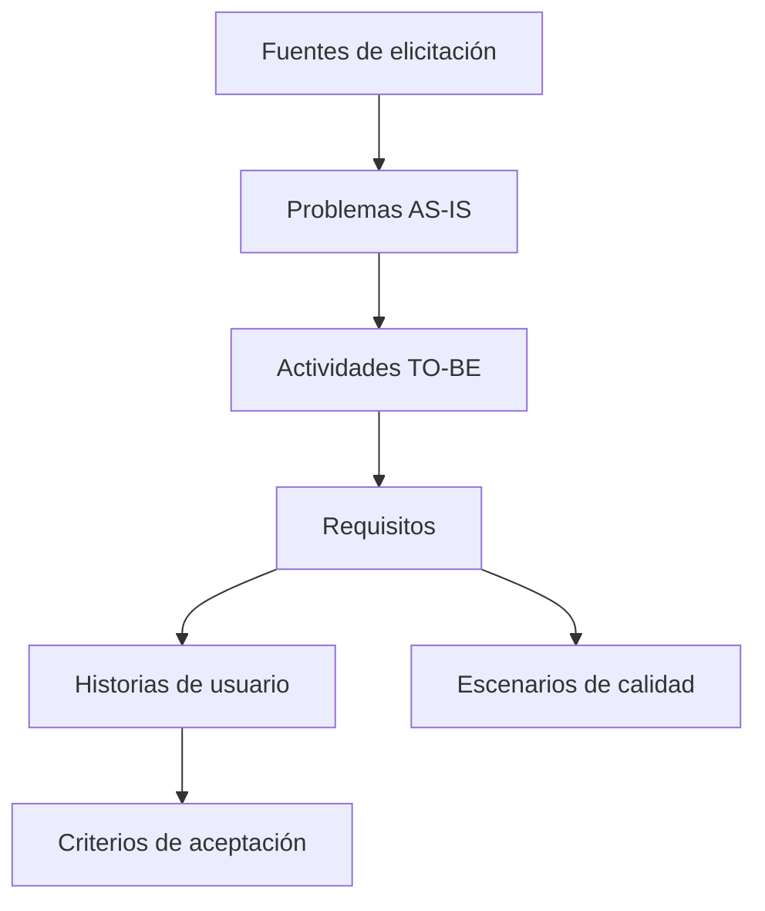

# Matriz de trazabilidad del proyecto

> **Proyecto:** OncoTrace – Plataforma de Trazabilidad, Gestión, Evaluación y Acompañamiento Oncológico  
> **Institución:** Hospital Dr. Gustavo Fricke (HGF) – Unidad de Gestión de Casos Oncológicos (UGCO)  
> **Asignatura:** CIN324 – Ingeniería de Requisitos | Entrega 1  
> **Alcance:** Relaciona los problemas AS-IS con sus fuentes de elicitación, actividades TO-BE, requisitos de producto, historias de usuario, criterios de aceptación y escenarios de calidad. Los requisitos de proyecto se documentan por separado en 03-requisitos.md.

**Documentos de referencia:** [AS-IS](./01-proceso-as-is.md) · [TO-BE](./02-rediseno-to-be.md) · [Requisitos](./03-requisitos.md) · [Historias de usuario](./04-historias-usuario.md) · [Elicitación](./05-elicitacion.md) · [Calidad](./06-atributos-calidad.md).

---

## 1. Nomenclatura y flujo de trazabilidad

Una actividad puede atender varios problemas y un requisito no funcional puede aplicarse a varias actividades. El esquema representa relaciones entre documentos, no una secuencia temporal obligatoria de elicitación.

| Prefijo | Tipo de elemento | Descripción |
| :--- | :--- | :--- |
| **AS-xx** | Problema AS-IS | Brecha, cuello de botella o problema operativo del proceso actual (AS-01 a AS-06). |
| **EL-xx** | Fuente de elicitación | Entrevista, revisión normativa o revisión de manuales utilizada para levantar necesidades (EL-01 a EL-03). |
| **TB-xx** | Actividad TO-BE | Actividad rediseñada para atender una brecha del proceso (TB-01 a TB-11). |
| **RF-xx** | Requisito funcional | Capacidad o servicio que debe ofrecer el sistema (RF-01 a RF-11). |
| **RNF-xx** | Requisito no funcional | Condición de fiabilidad, eficiencia, seguridad o interoperabilidad (RNF-01 a RNF-04). RNF-03 se aplica a las actividades que manejan información clínica, de TB-01 a TB-11. |
| **REQ-DER-xx** | Requisito derivado | Necesidad técnica derivada de otro requisito. REQ-DER-01 define el SSO institucional de funcionarios a partir de RNF-03. |
| **RP-xx** | Requisito de proyecto | Condición de gestión del trabajo y de sus entregas. RP-01 a RP-03 se documentan en 03-requisitos.md. |
| **HU-xx** | Historia de usuario | Necesidad expresada mediante rol, funcionalidad y beneficio (HU-01 a HU-11). |
| **HU-xx-CAy** | Criterio de aceptación | Condición para verificar una historia de usuario. |
| **AC-xx** | Escenario de calidad | Escenario que define cómo evaluar un atributo priorizado de ISO/IEC 25010:2023 (AC-01 a AC-03). |

---

## 2. Tabla general de trazabilidad

Los vínculos funcionales se toman de 03-requisitos.md y 04-historias-usuario.md. Los RNF se incluyen según las asociaciones documentadas en esos archivos; en particular, HU-08 cita RNF-01 para la disponibilidad del seguimiento de derivaciones.

| ID AS-IS | Problema AS-IS | Fuente EL | ID TO-BE | Solución TO-BE | Requisito (RF / RNF / derivado) | Historia de usuario | Criterios de aceptación | Calidad o verificación |
| :--- | :--- | :--- | :--- | :--- | :--- | :--- | :--- | :--- |
| **AS-01** | Resultados diagnósticos dispersos en LIS, PACS y papel | **EL-01** **EL-03** | **TB-01** **TB-05** | Tablero y línea de tiempo Consolidación de informes y alertas críticas | **RF-01** **RF-05** **RNF-01** **RNF-02** **RNF-03** **RNF-04** | [HU-01](./04-historias-usuario.md#hu-01) [HU-05](./04-historias-usuario.md#hu-05) | HU-01-CA1 a HU-01-CA6 HU-05-CA1 a HU-05-CA6 | **AC-01:** acceso y auditoría **AC-02:** disponibilidad y recuperación **AC-03:** desempeño del tablero **RNF-04:** interfaces LIS/PACS |
| **AS-02** | Preparación manual de comités y actas en papel | **EL-01** **EL-02** **EL-03** | **TB-06** **TB-07** | Ficha de presentación Acta digital, firma y reporte REM 7 | **RF-06** **RF-07** **RNF-03** **REQ-DER-01** | [HU-06](./04-historias-usuario.md#hu-06) [HU-07](./04-historias-usuario.md#hu-07) | HU-06-CA1 a HU-06-CA5 HU-07-CA1 a HU-07-CA5 | **AC-01:** acceso y auditoría SSO institucional Comité registrado como hito |
| **AS-03** | Pérdida de trazabilidad en derivaciones externas y falta de orientación sobre pasajes | **EL-01** **EL-03** | **TB-08** | Dossier digital, seguimiento de estados y constancia de entrega del Anexo 6 | **RF-08** **RNF-01** (citado en HU-08) **RNF-03** | [HU-08](./04-historias-usuario.md#hu-08) | HU-08-CA1 a HU-08-CA6 | **AC-01:** acceso y auditoría **AC-02:** disponibilidad y recuperación Estados de derivación y entrega del instructivo |
| **AS-04** | Monitoreo manual de plazos GES en planillas | **EL-02** **EL-03** | **TB-01** **TB-04** | Visualización de alertas en tablero Motor preventivo de plazos GES | **RF-01** **RF-04** **RNF-01** **RNF-02** **RNF-03** | [HU-01](./04-historias-usuario.md#hu-01) [HU-04](./04-historias-usuario.md#hu-04) | HU-01-CA1 a HU-01-CA6 HU-04-CA1 a HU-04-CA7 | **AC-01:** acceso y auditoría **AC-02:** disponibilidad y recuperación **AC-03:** desempeño del tablero Estados y no duplicidad de alertas |
| **AS-05** | Registro fragmentado y falta de interoperabilidad con MINSAL | **EL-01** **EL-02** **EL-03** | **TB-02** **TB-03** **TB-04** **TB-11** | Evaluación por dominios Bitácora de contactos Detección de inactividad Intercambio de seguimiento con MINSAL | **RF-02** **RF-03** **RF-04** **RF-11** **RNF-01** **RNF-03** **RNF-04** **REQ-DER-01** | [HU-02](./04-historias-usuario.md#hu-02) [HU-03](./04-historias-usuario.md#hu-03) [HU-04](./04-historias-usuario.md#hu-04) [HU-11](./04-historias-usuario.md#hu-11) | HU-02-CA1 a HU-02-CA7 HU-03-CA1 a HU-03-CA6 HU-04-CA3 HU-11-CA1 a HU-11-CA6 | **AC-01:** acceso y auditoría **AC-02:** disponibilidad del motor de alertas Integridad de contactos y cálculo de riesgo Habilitación, confirmaciones, errores y reintentos de MINSAL |
| **AS-06** | Interrupciones por demanda espontánea en el mesón | **EL-01** **EL-03** | **TB-03** **TB-09** **TB-10** | Registro compartido de contactos Tótem de autoatención Orientación y triage presencial | **RF-03** **RF-09** **RF-10** **RNF-03** | [HU-03](./04-historias-usuario.md#hu-03) [HU-09](./04-historias-usuario.md#hu-09) [HU-10](./04-historias-usuario.md#hu-10) | HU-03-CA1 a HU-03-CA6 HU-09-CA1 a HU-09-CA5 HU-10-CA1 a HU-10-CA5 | **AC-01:** acceso y auditoría Identidad y autorización del cuidador Confidencialidad y cierre de sesión Orientación ante urgencias y derivación a personal |

---

## 3. Detalle de la trazabilidad por instancia

### Instancia 1 — Flujo diagnóstico y tablero clínico

- **Problema AS-IS:** AS-01, dispersión de resultados diagnósticos.
- **Fuentes:** EL-01 y EL-03, por la búsqueda manual de resultados en sistemas separados.
- **Actividades TO-BE:**
  - **TB-01:** Tablero con ocho etapas y línea de tiempo de hitos asistenciales.
  - **TB-05:** Consolidación de informes LIS/PACS y notificación de hallazgos críticos.
- **Requisitos:** RF-01, RF-05, RNF-01, RNF-02, RNF-03 y RNF-04.
- **Historias y criterios:**
  - [HU-01](./04-historias-usuario.md#hu-01): HU-01-CA1 a HU-01-CA6.
  - [HU-05](./04-historias-usuario.md#hu-05): HU-05-CA1 a HU-05-CA6.
- **Verificación:** AC-01 para acceso y auditoría, AC-02 para disponibilidad y recuperación, AC-03 para desempeño del tablero y los criterios de HU-05 para indexación, completitud y tratamiento de discrepancias de identidad.

Las ocho etapas son: sospecha; confirmación diagnóstica; etapificación; tratamiento; rehabilitación; cuidados paliativos y alivio del dolor; seguimiento y sobrevivientes; alta y contrarreferencia. La presentación y la resolución del comité se registran como hitos, según HU-01-CA1 y HU-01-CA5.

---

### Instancia 2 — Evaluación multidimensional y acompañamiento

- **Problema AS-IS:** AS-05, registro fragmentado de evaluaciones y contactos.
- **Fuentes:** EL-01, EL-02 y EL-03, por las necesidades de valoración integral y acompañamiento.
- **Actividades TO-BE:**
  - **TB-02:** Evaluación clínico-funcional, psicosocial y socioeconómica, familiar y del cuidador, y espiritual y de comprensión diagnóstica.
  - **TB-03:** Bitácora de acompañamiento con los seis puntos de contacto definidos por la UGCO.
- **Requisitos:** RF-02, RF-03 y RNF-03.
- **Historias y criterios:**
  - [HU-02](./04-historias-usuario.md#hu-02): HU-02-CA1 a HU-02-CA7.
  - [HU-03](./04-historias-usuario.md#hu-03): HU-03-CA1 a HU-03-CA6.
- **Verificación:** registro ECOG cuando corresponda, cálculo y visualización del riesgo, historial de evaluaciones, programación de contactos y correcciones mediante adendas. AC-01 se aplica al acceso y la auditoría de la información clínica.

---

### Instancia 3 — Alertas de plazos GES e inactividad

- **Problemas AS-IS:** AS-04, monitoreo manual de plazos; AS-05, dificultades para detectar casos sin seguimiento.
- **Fuentes:** EL-02 y EL-03, por el seguimiento de garantías GES y la continuidad de la atención.
- **Actividad TO-BE:** TB-04, motor de alertas preventivas GES e inactividad.
- **Requisitos:** RF-04, RNF-01 y RNF-03.
- **Historia y criterios:** [HU-04](./04-historias-usuario.md#hu-04), HU-04-CA1 a HU-04-CA7.
- **Verificación funcional:**
  - Alerta preventiva cuando falten cinco días hábiles o menos para el vencimiento, según RF-04 y HU-04-CA1.
  - Alerta por inactividad superior a 15 días corridos, según HU-04-CA3.
  - Distinción entre los estados En gestión, Resuelta y No aplica, según HU-04-CA5.
  - Ausencia de alertas duplicadas mientras la condición siga activa, según HU-04-CA7.
- **Verificación de calidad:** AC-01 para acceso y auditoría; AC-02 para disponibilidad y recuperación.

El tablero que muestra estas alertas se relaciona con TB-01, RF-01 y HU-01. Su desempeño se evalúa mediante RNF-02 y AC-03.

---

### Instancia 4 — Gestión de comités oncológicos

- **Problema AS-IS:** AS-02, preparación manual de fichas y registro de actas en papel.
- **Fuentes:** EL-01, EL-02 y EL-03, por la preparación de antecedentes, el registro de decisiones y el reporte REM 7.
- **Actividades TO-BE:**
  - **TB-06:** Generación de la ficha de presentación con antecedentes clínicos, imágenes y biopsias.
  - **TB-07:** Registro de la conducta terapéutica, firma electrónica y generación del reporte REM 7.
- **Requisitos:** RF-06, RF-07, RNF-03 y REQ-DER-01.
- **Historias y criterios:**
  - [HU-06](./04-historias-usuario.md#hu-06): HU-06-CA1 a HU-06-CA5.
  - [HU-07](./04-historias-usuario.md#hu-07): HU-07-CA1 a HU-07-CA5.
- **Verificación:** prerrequisitos de presentación, acta firmada y protegida frente a modificaciones ordinarias, reporte REM 7 y tareas de seguimiento. AC-01 y REQ-DER-01 cubren el acceso, la auditoría y el SSO institucional.

La firma del acta registra la resolución como un hito y genera las tareas correspondientes. El cambio de etapa requiere el evento clínico definido en HU-01-CA5; la firma no lo produce por sí sola, conforme a HU-07-CA5.

---

### Instancia 5 — Derivaciones externas y reembolso de pasajes

- **Problema AS-IS:** AS-03, falta de seguimiento del dossier y de la atención en la red externa.
- **Fuentes:** EL-01 y EL-03, por el circuito TENS / UGAA / HCVB y la entrega del instructivo de reembolso de pasajes.
- **Actividad TO-BE:** TB-08, dossier digital, seguimiento de la derivación y constancia de entrega del Anexo 6.
- **Requisitos:** RF-08, RNF-01 —citado en HU-08— y RNF-03.
- **Historia y criterios:** [HU-08](./04-historias-usuario.md#hu-08), HU-08-CA1 a HU-08-CA6.
- **Verificación:** confección y despacho del dossier, acuse de recibo, seguimiento de estados, alerta de rezago, incorporación de la epicrisis y constancia de entrega del instructivo. AC-01 cubre el acceso y la auditoría; AC-02 corresponde a la disponibilidad y recuperación citadas por HU-08.

Los estados se conservan según HU-08-CA3: Dossier confeccionado → Despachado por UGAA → Recepcionado en HCVB → Cita asignada → Tratamiento iniciado → Contrarreferido con epicrisis.

---

### Instancia 6 — Autoatención y triage presencial

- **Problema AS-IS:** AS-06, interrupciones por consultas espontáneas en el mesón.
- **Fuentes:** EL-01 y EL-03, por la demanda de orientación y la carga de atención presencial.
- **Actividades TO-BE:**
  - **TB-03:** Bitácora compartida de contactos, asociada a AS-06 en HU-03.
  - **TB-09:** Consulta de trámites desde el tótem con verificación de identidad autorizada por el hospital.
  - **TB-10:** Orientación institucional, priorización de solicitudes y emisión de tickets.
- **Requisitos:** RF-03, RF-09, RF-10 y RNF-03.
- **Historias y criterios:**
  - [HU-03](./04-historias-usuario.md#hu-03): HU-03-CA1 a HU-03-CA6.
  - [HU-09](./04-historias-usuario.md#hu-09): HU-09-CA1 a HU-09-CA5.
  - [HU-10](./04-historias-usuario.md#hu-10): HU-10-CA1 a HU-10-CA5.
- **Verificación:** identidad y autorización vigente del cuidador, estados consultables sin exponer diagnósticos, cierre de sesión y registro de contactos. El asistente orienta ante posibles urgencias y ofrece contacto con personal cuando no puede clasificar la solicitud. AC-01 se aplica al acceso y la auditoría.

---

### Instancia 7 — Intercambio de información con MINSAL

- **Problema AS-IS:** AS-05, registro local sin interoperabilidad con la Plataforma de Seguimiento Oncológico del MINSAL y doble digitación.
- **Fuentes:** EL-01 y EL-03, según la trazabilidad de HU-11.
- **Actividad TO-BE:** TB-11, intercambio de datos de seguimiento autorizado por HGF y MINSAL.
- **Requisitos:** RF-11, RNF-04, RNF-03 y REQ-DER-01.
- **Historia y criterios:** [HU-11](./04-historias-usuario.md#hu-11), HU-11-CA1 a HU-11-CA6.
- **Verificación funcional:**
  - **HU-11-CA1:** envío deshabilitado hasta que la integración esté habilitada según el acuerdo institucional.
  - **HU-11-CA2:** datos, mecanismo y periodicidad acordados por HGF y MINSAL.
  - **HU-11-CA3:** identificación y seguimiento del estado de cada envío.
  - **HU-11-CA4:** confirmación válida antes de presentar un envío como recibido.
  - **HU-11-CA5:** registro de errores, historial de intentos y comprobación del estado antes de reenviar.
  - **HU-11-CA6:** consulta y reintentos restringidos a funcionarios autenticados y autorizados, con auditoría.
- **Verificación de calidad:** RNF-04 para el intercambio institucional, AC-01 para acceso y auditoría, y REQ-DER-01 para el SSO de los funcionarios.

La integración permanece condicionada a su acuerdo y habilitación institucional. Esta matriz no asigna un protocolo, una dirección bidireccional ni una prioridad distinta de la indicada en HU-11.

---

## 4. Cierre de la revisión

La matriz reúne seis problemas AS-IS, las once actividades TB-01 a TB-11, los once requisitos RF-01 a RF-11 y las once historias HU-01 a HU-11. Los requisitos no funcionales y el requisito derivado se relacionan con las actividades e historias indicadas en las secciones anteriores.

Las metas de calidad se mantienen según 03-requisitos.md y 06-atributos-calidad.md:

| Escenario | Requisitos asociados | Medidas documentadas |
| :--- | :--- | :--- |
| **AC-01 — Seguridad de la información** | RNF-03 y REQ-DER-01 | Registro del 100 % de accesos e intentos de consulta, modificación o exportación; rechazo de accesos no autorizados; persistencia de auditoría en 50 milisegundos o menos. |
| **AC-02 — Fiabilidad** | RNF-01 | Disponibilidad mensual de al menos 99,5 % entre las 08:00 y las 18:00; RTO de cinco minutos o menos; RPO igual a cero, sin pérdida de transacciones clínicas confirmadas. |
| **AC-03 — Eficiencia de desempeño** | RNF-02 | Carga y visualización del tablero en 2,0 segundos o menos con más de 1.000 pacientes con alertas activas y 50 usuarios concurrentes; uso de CPU del servidor de aplicaciones de 70 % o menos. |

Los criterios de aceptación y los escenarios establecen condiciones de verificación. Su inclusión en la matriz no acredita que el sistema ya esté implementado o que esas medidas se hayan alcanzado. Los requisitos de proyecto RP-01 a RP-03 se consultan en 03-requisitos.md.
