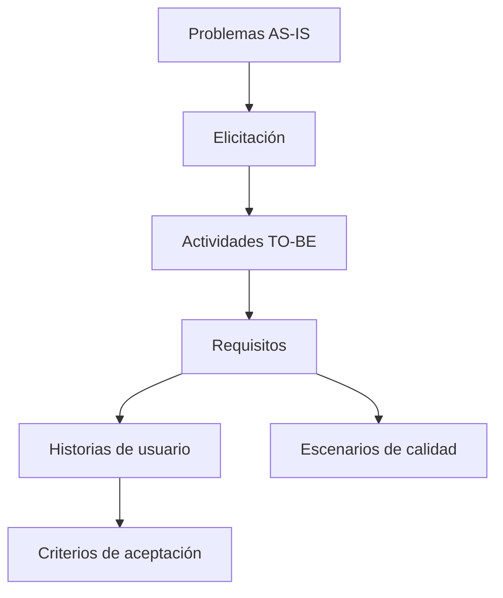

# Matriz de trazabilidad del proyecto

> **Proyecto:** OncoTrace – Plataforma de Trazabilidad, Gestión, Evaluación y Acompañamiento Oncológico  
> **Institución:** Hospital Dr. Gustavo Fricke (HGF) – Unidad de Gestión de Casos Oncológicos (UGCO)  
> **Asignatura:** CIN324 – Ingeniería de Requisitos | Entrega 1  
> **Alcance:** Relaciona los problemas del proceso actual (AS-IS) con sus fuentes de elicitación, actividades TO-BE, requisitos de producto (RF y RNF), historias de usuario (HU), criterios de aceptación (CA) y escenarios de calidad (ISO/IEC 25010). Los requisitos de proyecto (RP) se documentan por separado.

---

## 1. Nomenclatura y flujo de trazabilidad

| Prefijo | Tipo de elemento | Descripción |
| :--- | :--- | :--- |
| **AS-xx** | **Problema AS-IS** | Falla, cuello de botella o problema operativo del proceso actual de atención oncológica. |
| **EL-xx** | **Fuente de elicitación** | Entrevista, normativa o manual utilizado para levantar y validar una necesidad. |
| **TB-xx** | **Actividad TO-BE** | Actividad o solución rediseñada para atender una brecha del proceso (TB-01 a TB-10). |
| **RF-xx** | **Requisito funcional** | Capacidad o servicio que debe ofrecer el sistema (RF-01 a RF-10). |
| **RNF-xx** | **Requisito no funcional** | Restricción de calidad o técnica, como fiabilidad, eficiencia, seguridad o interoperabilidad (RNF-01 a RNF-04). |
| **REQ-DER-xx** | **Requisito derivado** | Necesidad técnica derivada de otro requisito; en este proyecto, REQ-DER-01 define la autenticación institucional mediante SSO. |
| **RP-xx** | **Requisito de proyecto** | Condición para gestionar el trabajo y sus entregas; RP-01 a RP-03 se describen en `03-requisitos.md`. |
| **HU-xx** | **Historia de usuario** | Necesidad de un rol del equipo clínico, de gestión o del paciente (HU-01 a HU-10). |
| **HU-xx-CAy** | **Criterio de aceptación** | Regla objetiva para verificar el cumplimiento de una historia de usuario. |
| **AC-xx** | **Escenario de calidad** | Escenario SEI que permite medir un atributo de calidad ISO/IEC 25010 (AC-01 a AC-03). |

---

## 2. Tabla general de trazabilidad

| ID AS-IS | Problema AS-IS | Fuente EL | ID TO-BE | Solución TO-BE | Requisito (RF / RNF) | Historia de usuario | Criterios de aceptación (CA) | Atributo de calidad o verificación |
| :--- | :--- | :--- | :--- | :--- | :--- | :--- | :--- | :--- |
| **AS-01** | **Dispersión de resultados diagnósticos** en múltiples LIS/PACS y papel | **EL-01** (Entrevista) **EL-03** (Manual UGCO) | **TB-01** **TB-05** | Tablero Kanban y línea de tiempo Indexación y consolidación automática | **RF-01** **RF-05** **RNF-02** **RNF-04** | [HU-01](./04-historias-usuario.md#hu-01) [HU-05](./04-historias-usuario.md#hu-05) | HU-01-CA1 a HU-01-CA6 HU-05-CA1 a HU-05-CA6 | **AC-03** (más de 1.000 pacientes con alertas activas y 50 usuarios: carga ≤ 2,0 s; CPU ≤ 70 %) **RNF-04** (HL7 FHIR / API REST) |
| **AS-02** | **Gestión manual de comités oncológicos** (Word y papel sin integración) | **EL-01** (Entrevista) **EL-02** (Normativa) **EL-03** (Manual UGCO) | **TB-06** **TB-07** | Ficha resumen autogenerada Acta digital con firma y REM 7 | **RF-06** **RF-07** **RNF-03** **REQ-DER-01** | [HU-06](./04-historias-usuario.md#hu-06) [HU-07](./04-historias-usuario.md#hu-07) | HU-06-CA1 a HU-06-CA5 HU-07-CA1 a HU-07-CA5 | **AC-01** (registro del 100 % de accesos e intentos) **REQ-DER-01** (SSO institucional) |
| **AS-03** | **Pérdida de trazabilidad en derivaciones** (dossier TENS → UGAA → HCVB y falta de información sobre pasajes) | **EL-01** (Entrevista) **EL-03** (Manual UGCO v2.0) | **TB-08** | Dossier digital, seguimiento de la derivación y entrega del instructivo de reembolso | **RF-08** | [HU-08](./04-historias-usuario.md#hu-08) | HU-08-CA1 a HU-08-CA6 | Seguimiento de estados y entrega del Anexo 6 junto a Servicio Social |
| **AS-04** | **Monitoreo manual de plazos GES** en planillas de cálculo | **EL-02** (Normativa GES) **EL-03** (DS N° 29 / UGCO) | **TB-01** **TB-04** | Visualización en tablero Kanban Motor de alertas preventivas GES | **RF-01** **RF-04** **RNF-01** | [HU-01](./04-historias-usuario.md#hu-01) [HU-04](./04-historias-usuario.md#hu-04) | HU-01-CA2, HU-01-CA4 HU-04-CA1 a HU-04-CA7 | **AC-02** (disponibilidad ≥ 99,5 % y RTO ≤ 5 min) Alerta cuando falten 5 días hábiles o menos (DS N° 29) |
| **AS-05** | **Registro fragmentado y falta de bitácora estandarizada** | **EL-01** (Entrevista) **EL-02** (Ley N° 21.258) **EL-03** (Manual UGCO) | **TB-02** **TB-03** **TB-04** | Evaluación por dominios Bitácora de contactos Alerta por inactividad superior a 15 días | **RF-02** **RF-03** **RF-04** | [HU-02](./04-historias-usuario.md#hu-02) [HU-03](./04-historias-usuario.md#hu-03) [HU-04](./04-historias-usuario.md#hu-04) | HU-02-CA1 a HU-02-CA7 HU-03-CA1 a HU-03-CA6 HU-04-CA3 (riesgo de inactividad) | Escala ECOG (0–4); cálculo de riesgo; integridad de la bitácora (`HU-03-CA6`); seis puntos de contacto |
| **AS-06** | **Interrupciones por demanda espontánea** en el mesón presencial | **EL-01** (Entrevista) **EL-02** (Ley N° 21.258) **EL-03** (Manual UGCO) | **TB-09** **TB-10** | Tótem de autoatención Asistente virtual y triage presencial | **RF-09** **RF-10** **RNF-03** | [HU-09](./04-historias-usuario.md#hu-09) [HU-10](./04-historias-usuario.md#hu-10) | HU-09-CA1 a HU-09-CA5 HU-10-CA1 a HU-10-CA5 | Verificación de identidad y autorización del cuidador; confidencialidad (`HU-09-CA4`); cierre de sesión (`HU-09-CA5`); orientación ante urgencias y derivación a personal (`HU-10-CA4` y `HU-10-CA5`) |

---

## 3. Detalle de la trazabilidad por instancia

### Instancia 1 — Flujo diagnóstico y tablero clínico
- **Nodo AS-IS:** **AS-01** (Dispersión de resultados diagnósticos)
- **Elicitación:** **EL-01** (Entrevista a Gestora) y **EL-03** (Manual de Procedimientos UGCO, búsqueda manual en Pathology, PACS y LIS).
- **Actividades TO-BE:**
  - **TB-01:** Tablero Kanban con ocho etapas de atención y línea de tiempo de hitos asistenciales.
  - **TB-05:** Consolidación e indexación automática de informes mediante integraciones LIS/PACS y notificación de valores críticos de AP.
- **Requisitos vinculados:**
  - `RF-01` (Tablero y Trazabilidad por Etapas)
  - `RF-05` (Consolidación Automática de Exámenes y Alertas Críticas)
  - `RNF-02` (eficiencia: mostrar las ocho columnas y completar la carga con más de 1.000 pacientes con alertas activas y 50 usuarios concurrentes en 2,0 segundos o menos; uso de CPU de 70 % o menos)
  - `RNF-04` (Interoperabilidad Hospitalaria HL7 FHIR / API REST)
- **Historias de usuario:**
  - [HU-01](./04-historias-usuario.md#hu-01) (tablero de trazabilidad) → criterios `HU-01-CA1` a `HU-01-CA6`
  - [HU-05](./04-historias-usuario.md#hu-05) (consolidación de biopsias) → criterios `HU-05-CA1` a `HU-05-CA6`
- **Verificación de calidad:** `AC-03` establece la carga y visualización de las ocho columnas en 2,0 segundos o menos, con más de 1.000 pacientes con alertas activas y 50 usuarios concurrentes; el uso de CPU debe ser de 70 % o menos.

---

### Instancia 2 — Evaluación multidimensional y acompañamiento
- **Nodo AS-IS:** **AS-05** (Registro fragmentado y falta de bitácora estandarizada)
- **Elicitación:** **EL-01** (Entrevista), **EL-02** (Ley N° 21.258: exigencia de acompañamiento integral) y **EL-03** (Manual de Procedimientos: pauta de valoración por dominios y seis puntos de contacto obligatorio).
- **Actividades TO-BE:**
  - **TB-02:** Ficha de evaluación multidimensional por dominios (clínico-funcional ECOG 0–4, psicoemocional, cuidador/sobrecarga, socioeconómico, espiritual).
  - **TB-03:** Bitácora digital inmutable de acompañamiento con programación de los seis puntos de contacto obligatorio normados.
- **Requisitos vinculados:**
  - `RF-02` (evaluación multidimensional por dominios)
  - `RF-03` (bitácora de puntos de contacto)
- **Historias de usuario:**
  - [HU-02](./04-historias-usuario.md#hu-02) (evaluación multidimensional) → criterios `HU-02-CA1` a `HU-02-CA7`
  - [HU-03](./04-historias-usuario.md#hu-03) (bitácora de acompañamiento) → criterios `HU-03-CA1` a `HU-03-CA6`
- **Verificaciones asociadas:** evaluación ECOG, cálculo de riesgo (`RF-02`) e integridad del registro de contactos (`HU-03-CA6`).

---

### Instancia 3 — Alertas de plazos GES e inactividad
- **Nodo AS-IS:** **AS-04** (Monitoreo manual de plazos en Excel) y **AS-05** (Riesgo de abandono/deserción)
- **Elicitación:** **EL-02** (Revisión Normativa GES) y **EL-03** (Manual de Organización: 21 problemas oncológicos GES según Decreto Supremo N° 29).
- **Actividades TO-BE:**
  - **TB-04:** Motor de alertas preventivas cuando falten cinco días hábiles o menos para el vencimiento y por inactividad superior a 15 días corridos.
- **Requisitos vinculados:**
  - `RF-04` (Motor de Alertas Preventivas GES e Inactividad)
  - `RNF-01` (Fiabilidad y Disponibilidad Operativa)
- **Historia de usuario:** [HU-04](./04-historias-usuario.md#hu-04) (alertas de plazos GES e inactividad) → criterios `HU-04-CA1` a `HU-04-CA7`.
- **Verificación de calidad:** `AC-02` establece disponibilidad mensual de al menos 99,5 % entre las 08:00 y las 18:00, RTO de cinco minutos o menos y RPO = 0 (sin pérdida de transacciones clínicas confirmadas). `HU-04-CA7` verifica que no se generen alertas duplicadas.

---

### Instancia 4 — Gestión de comités oncológicos
- **Nodo AS-IS:** **AS-02** (Preparación manual en Word y actas físicas en papel sin integración)
- **Elicitación:** **EL-01** (Entrevista: sobrecarga de preparación), **EL-02** (Normativa GES) y **EL-03** (Manual de Procedimientos v2.0 final: registro estadístico REM 7).
- **Actividades TO-BE:**
  - **TB-06:** Generación de la ficha resumen de presentación con antecedentes clínicos, imágenes y biopsias.
  - **TB-07:** Registro de la conducta terapéutica, firma electrónica del acta y generación del reporte REM 7.
- **Requisitos vinculados:**
  - `RF-06` (Generación Digital de Ficha de Comité)
  - `RF-07` (Acta Digital de Comité y Registro REM 7)
  - `RNF-03` (Seguridad y Confidencialidad Clínica)
  - `REQ-DER-01` (Single Sign-On Institucional con Directorio Activo HGF)
- **Historias de usuario:**
  - [HU-06](./04-historias-usuario.md#hu-06) (ficha de presentación a comité) → criterios `HU-06-CA1` a `HU-06-CA5`
  - [HU-07](./04-historias-usuario.md#hu-07) (acta digital de comité) → criterios `HU-07-CA1` a `HU-07-CA5`
- **Verificación de calidad:** `AC-01` establece el registro del 100 % de accesos e intentos, y la persistencia del registro de auditoría en 50 milisegundos o menos. `REQ-DER-01` define el inicio de sesión institucional.

---

### Instancia 5 — Derivaciones externas y reembolso de pasajes
- **Nodo AS-IS:** **AS-03** (Punto ciego y pérdida de trazabilidad en derivaciones físicas a Van Buren y desorientación de beneficios de pasajes)
- **Elicitación:** **EL-01** (Entrevista) y **EL-03** (Manual de Procedimientos UGCO v2.0 final: confección de dossier por TENS, despacho por UGAA e instructivo de Reembolso de Pasajes Anexo 6 de Servicio Social).
- **Actividades TO-BE:**
  - **TB-08:** Dossier digital y seguimiento de estados: `Dossier confeccionado` → `Despachado por UGAA` → `Recepcionado por HCVB` → `Cita asignada` → `Tratamiento iniciado` → `Contrarreferido`. Incluye la entrega del instructivo de reembolso de pasajes (Anexo 6).
- **Requisitos vinculados:**
  - `RF-08` (derivaciones externas, dossier digital y reembolso de pasajes)
- **Historia de usuario:** [HU-08](./04-historias-usuario.md#hu-08) (trazabilidad de derivaciones y reembolso de pasajes) → criterios `HU-08-CA1` a `HU-08-CA6`.
- **Verificación asociada:** registro del estado de la derivación y de la entrega del Anexo 6.

---

### Instancia 6 — Autoatención y triage presencial
- **Nodo AS-IS:** **AS-06** (Interrupciones críticas por demanda espontánea presencial en oficina de gestión)
- **Elicitación:** **EL-01** (Entrevista: obligación legal de atención bajo Ley N° 21.258 que colapsa el tiempo asistencial) y **EL-03** (Manual de Organización: acogida continua y alta carga presencial).
- **Actividades TO-BE:**
  - **TB-09:** Tótem de autoatención con el método de verificación de identidad definido por el hospital. La lectura de la cédula o el ingreso del RUN no basta por sí solo; el acceso de cuidadores requiere autorización vigente.
  - **TB-10:** Asistente virtual institucional para orientar sobre los derechos de la Ley del Cáncer, priorizar solicitudes de atención presencial y emitir tickets. No reemplaza una evaluación clínica.
- **Requisitos vinculados:**
  - `RF-09` (Tótem de Autoatención en Sala de Espera)
  - `RF-10` (Asistente Virtual y Triage Asistencial)
  - `RNF-03` (Seguridad y Confidencialidad Clínica, aplicable al acceso del tótem)
- **Historias de usuario:**
  - [HU-09](./04-historias-usuario.md#hu-09) (tótem de autoatención) → criterios `HU-09-CA1` a `HU-09-CA5`
  - [HU-10](./04-historias-usuario.md#hu-10) (asistente virtual y triage) → criterios `HU-10-CA1` a `HU-10-CA5`
- **Verificaciones asociadas:** identidad y autorización del cuidador (`HU-09-CA1` y `HU-09-CA2`), confidencialidad (`HU-09-CA4`), cierre de sesión (`HU-09-CA5`), orientación ante urgencias (`HU-10-CA4`) y derivación a personal cuando no se pueda clasificar la solicitud (`HU-10-CA5`).

---

## 4. Cierre de la revisión

1. **Cobertura de problemas:** Los seis nodos críticos AS-01 a AS-06 cuentan con actividades TO-BE asociadas en la matriz.
2. **Relación con las fuentes:** Los requisitos de producto y derivados se relacionan con las fuentes de elicitación indicadas en cada instancia. Los requisitos de proyecto RP-01 a RP-03 se documentan en `03-requisitos.md`.
3. **Criterios verificables:** Las diez historias de usuario cuentan con criterios de aceptación. Los escenarios AC-01 a AC-03 describen medidas para seguridad, fiabilidad y eficiencia, vinculadas con los requisitos indicados.
