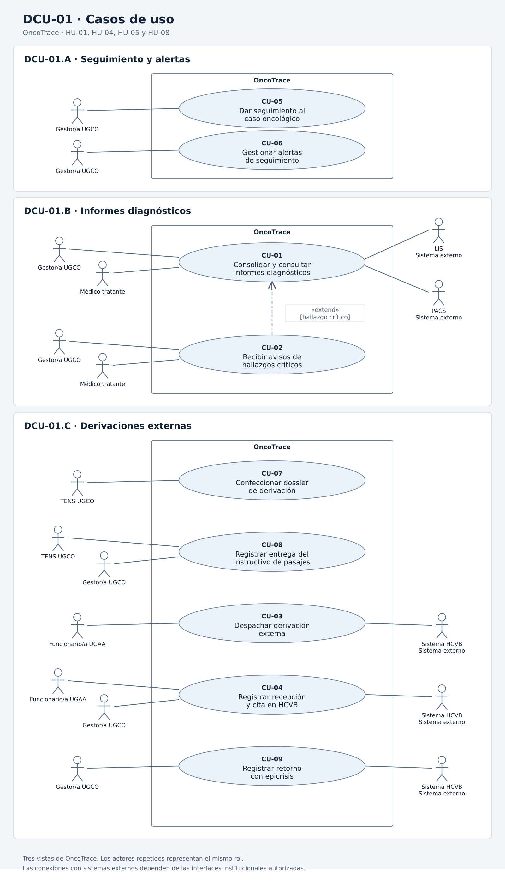

# Casos de uso

Este documento presenta los objetivos de los actores que participan en las historias HU-01, HU-04, HU-05 y HU-08. El alcance coincide con los [criterios de aceptación](./07-criterios-aceptacion.md) y el [modelo de dominio](./08-modelo-dominio.md) de la Entrega 2.

**Requisitos de origen:** RF-01, RF-04, RF-05 y RF-08 de [03-requisitos.md](./03-requisitos.md).

## Actores

| Actor | Tipo | Descripción |
| :--- | :--- | :--- |
| Gestor/a UGCO | Humano | Consulta y actualiza el seguimiento del caso dentro de sus permisos, gestiona alertas, consulta informes y coordina el seguimiento de las derivaciones. |
| Médico tratante | Humano | Consulta informes diagnósticos y recibe avisos de hallazgos críticos para su evaluación clínica. |
| TENS UGCO | Humano | Confecciona el dossier y registra la entrega del instructivo de pasajes cuando le corresponde. |
| Funcionario/a UGAA | Humano | Valida los antecedentes, formaliza el despacho y registra las respuestas de la derivación dentro de sus permisos. |
| LIS | Sistema externo | Proporciona informes de laboratorio y anatomía patológica y su condición de validación, según las interfaces institucionales disponibles. |
| PACS | Sistema externo | Proporciona informes radiológicos y su condición de validación, según las interfaces institucionales disponibles. |
| Sistema HCVB | Sistema externo | Representa el sistema del centro receptor en la integración propuesta para el despacho, la recepción, la cita y el retorno de las derivaciones. |

Los actores humanos deben estar autenticados y contar con los permisos correspondientes, según RNF-03 y REQ-DER-01. La autenticación y la auditoría son condiciones de los casos de uso, no objetivos separados en este diagrama.

La participación del Sistema HCVB describe una integración propuesta y condicionada a los mecanismos institucionales disponibles y autorizados. No acredita que exista una interfaz habilitada. El registro de una recepción siempre requiere la confirmación emitida por el centro receptor, conforme a HU-08.

Paciente y cuidador reciben el instructivo a través del personal de la UGCO. No se representan como usuarios directos de OncoTrace en estas cuatro historias. La autoatención de HU-09 y el intercambio con MINSAL de HU-11 quedan fuera del alcance seleccionado.

## Diagrama de casos de uso

**Identificador:** DCU-01.

Archivo fuente: [casos-de-uso.puml](./diagramas/casos-de-uso.puml).

La imagen reúne tres vistas del mismo sistema: seguimiento y alertas, informes diagnósticos y derivaciones externas. En cada vista, el rectángulo delimita OncoTrace y los actores quedan fuera. Un actor repetido representa el mismo rol.

## Casos de uso y su origen

Los códigos CU-01 a CU-04 conservan las áreas funcionales del modelo de integración de la Entrega 1. Sus nombres y relaciones se precisan aquí para expresar los objetivos de los actores. CU-05 a CU-09 completan el alcance de las historias seleccionadas.

| ID | Caso de uso | Actor principal | Historia de origen | Escenarios de aceptación |
| :--- | :--- | :--- | :--- | :--- |
| CU-01 | Consolidar y consultar informes diagnósticos | Gestor/a UGCO y médico tratante | [HU-05](./04-historias-usuario.md#hu-05) | HU-05-ESC-01, HU-05-ESC-03 y HU-05-ESC-04. |
| CU-02 | Recibir avisos de hallazgos críticos | Gestor/a UGCO y médico tratante | [HU-05](./04-historias-usuario.md#hu-05) | HU-05-ESC-02. |
| CU-03 | Despachar derivación externa | Funcionario/a UGAA | [HU-08](./04-historias-usuario.md#hu-08) | HU-08-ESC-02. |
| CU-04 | Registrar recepción y cita en HCVB | Funcionario/a UGAA y gestor/a UGCO | [HU-08](./04-historias-usuario.md#hu-08) | HU-08-ESC-03 y HU-08-ESC-04. |
| CU-05 | Dar seguimiento al caso oncológico | Gestor/a UGCO | [HU-01](./04-historias-usuario.md#hu-01) | HU-01-ESC-01 a HU-01-ESC-03. |
| CU-06 | Gestionar alertas de seguimiento | Gestor/a UGCO | [HU-04](./04-historias-usuario.md#hu-04) y [HU-08](./04-historias-usuario.md#hu-08) | HU-04-ESC-01 a HU-04-ESC-07 y HU-08-ESC-05. |
| CU-07 | Confeccionar dossier de derivación | TENS UGCO | [HU-08](./04-historias-usuario.md#hu-08) | HU-08-ESC-01. |
| CU-08 | Registrar entrega del instructivo de pasajes | Gestor/a UGCO o TENS UGCO | [HU-08](./04-historias-usuario.md#hu-08) | HU-08-ESC-02. |
| CU-09 | Registrar retorno con epicrisis | Gestor/a UGCO | [HU-08](./04-historias-usuario.md#hu-08) | HU-08-ESC-06. |

Los identificadores de escenarios corresponden a [07-criterios-aceptacion.md](./07-criterios-aceptacion.md). Un escenario puede intervenir en más de un caso de uso; por ejemplo, el despacho de HU-08-ESC-02 exige que la entrega del instructivo esté registrada.

## Relaciones entre los casos de uso

- **CU-02 extiende CU-01:** el aviso se produce cuando se incorpora un informe validado, asociado al paciente correcto, que contiene un hallazgo de malignidad o un valor crítico informado por el sistema de origen. El punto de extensión es la incorporación del informe. La flecha `extend` parte de CU-02 y apunta a CU-01.

- **CU-04 es independiente de CU-03:** la recepción y la asignación de una cita son hechos posteriores al despacho y pueden registrarse en interacciones distintas. No se modelan como una extensión ejecutada durante el despacho.

- **CU-08 es independiente de CU-03:** la entrega del instructivo puede registrarse anticipadamente. Para despachar a HCVB, su constancia debe existir, según HU-08-ESC-02. Esta condición no obliga a repetir la entrega cada vez que se consulta o formaliza el despacho.

- No se incorporan relaciones `include`: los casos se mantienen como objetivos identificables y las condiciones compartidas se explican en los criterios de aceptación.

## Reglas que se mantienen entre los artefactos

- **CU-05:** el caso sigue las ocho etapas definidas en el modelo de dominio. El comité es un hito; su resolución no cambia por sí sola la etapa asistencial.

- **CU-06:** las alertas se generan según los umbrales del documento 07. Una gestión registrada no equivale a cumplir una garantía. Las evaluaciones automáticas forman parte del comportamiento de OncoTrace; no se representan como un actor externo.

- **CU-01 y CU-02:** los informes pendientes de validación o con identificación discrepante no se consideran resultados correctamente incorporados. Un aviso de hallazgo crítico comunica un resultado informado por el origen y no sustituye la evaluación del médico.

- **CU-03 y CU-04:** despachar un dossier no acredita su recepción. Tampoco una cita asignada acredita el inicio del tratamiento. Cada avance requiere el antecedente correspondiente.

- **CU-07 y CU-08:** el dossier debe reunir los antecedentes requeridos y la resolución firmada del comité. La entrega del instructivo conserva su destinatario, fecha y responsable, de acuerdo con el modelo de dominio.

- **CU-09:** el retorno requiere la epicrisis y la contrarreferencia vinculadas al caso y deja un hito de seguimiento. No se presupone una transmisión automática desde HCVB.
