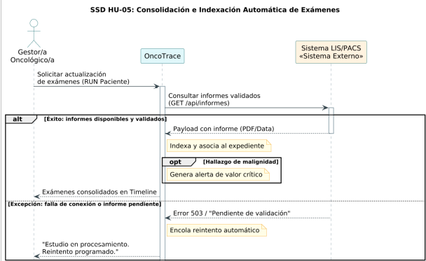
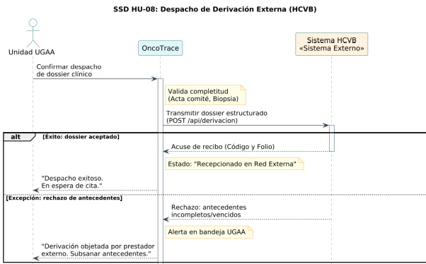

# Diagramas de secuencia de sistema

Este documento describe, mediante diagramas de secuencia del sistema (DSS), las interacciones de caja negra entre los actores externos y el núcleo de **OncoTrace** para las historias de usuario **HU-05** y **HU-08**.

**Referencias del Proyecto:**
* [Criterios de aceptación](./07-criterios-aceptacion.md)
* [Modelo de dominio](./08-modelo-dominio.md)
* [Casos de uso](./09-casos-de-uso.md)
* [Historias de usuario](./04-historias-usuario.md)

---

## DSS-01 — Incorporar y consultar informes diagnósticos

- Caso de uso: [CU-01, CU-02](./09-casos-de-uso.md)
- Historia: [HU-05](./04-historias-usuario.md#hu-05)
- Sistemas externos que participan: LIS / PACS, Servicio Validación RUN

Archivo fuente: [`./diagramas/diagramas-secuencia.puml`](./diagramas/diagramas-secuencia.puml)

Variantes representadas:
- **alt / else (Validación y RUN):** Maneja la incorporación exitosa con RUN validado frente a la discrepancia de identidades o informes no validados.
- **alt / else (Completitud parcial):** Actualiza al 50% la completitud en exámenes múltiples (HU-05-ESC-01) o al 100% al consolidarse.
- **opt (Hallazgo crítico):** Emisión prioritaria de notificaciones ante alertas clínicas (CU-02).
- **opt (Descarga en PDF):** Descarga diferida del documento en PDF.

### Descripción del flujo
El flujo contempla la ingesta automatizada o manual de informes provenientes de laboratorios (LIS) o imágenes médicas (PACS). El sistema evalúa el estado de validación del informe y contrasta el RUN del paciente con el caso oncológico activo. Cuando el informe cuenta con validación clínica y el RUN permite asociarlo inequívocamente, consolida el resultado. Si hay discrepancia, rechaza la incorporación automática y genera una alerta de revisión.

---

## DSS-02 — Gestionar derivación externa y retorno

- Caso de uso: [CU-03, CU-04, CU-06, CU-07, CU-08, CU-09](./09-casos-de-uso.md)
- Historia: [HU-08](./04-historias-usuario.md#hu-08)
- Sistemas externos que participan: Sistema Externo HCVB (Hospital Carlos van Buren)

Archivo fuente: [`./diagramas/diagramas-secuencia.puml`](./diagramas/diagramas-secuencia.puml)

Variantes representadas:
- **alt / else (Integración institucional):** Trasmisión automatizada a HCVB o registro manual por el usuario si la interfaz no está habilitada.
- **opt (Alerta de seguimiento):** Evaluación al día hábil 11 sin cita confirmada, conservando el estado "Despachado por UGAA" y disparando alerta (CU-06).
- **alt (Confirmación de cita):** Registro asíncrono de la fecha de atención en HCVB.

### Descripción del flujo
El diagrama detalla el ciclo de derivación a un centro de alta complejidad. El operador consolida el dossier digital, registra la entrega del instructivo de pasajes (Anexo 6) y formaliza el despacho. Transcurridos 11 días hábiles sin confirmación de cita, se activa una alerta automática de seguimiento. El proceso concluye con el registro del inicio del tratamiento y la recepción de la epicrisis de retorno.

---

## Correspondencia con la Entrega 2

| Diagrama | Historia y escenarios | Casos de uso | Actores Principales | Conceptos del modelo de dominio |
| :--- | :--- | :--- | :--- | :--- |
| **DSS-01** | HU-05-ESC-01 a HU-05-ESC-04 | CU-01 y CU-02 | LIS / PACS, Servicio RUN, Profesional Clínico | `CasoOncologico`, `OrdenExamen`, `EstudioDiagnostico` |
| **DSS-02** | HU-08-ESC-01 a HU-08-ESC-06 | CU-03, CU-04, CU-06, CU-07, CU-08, CU-09 | Gestor/a UGCO, Funcionario/a UGAA, Sistema HCVB | `CasoOncologico`, `DossierDigitalDerivacion`, `InstructivoReembolsoPasajes`, `ContraReferenciaEpicrisis`, `AlertaSeguimiento`, `HitoAsistencial` |
