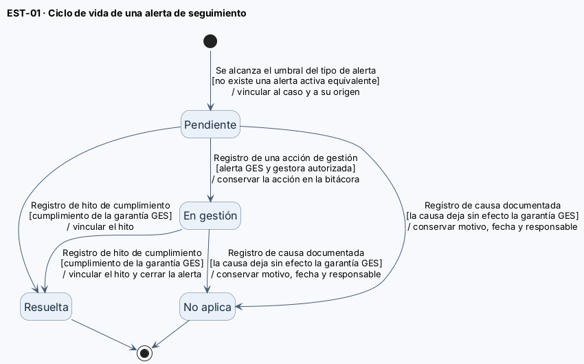
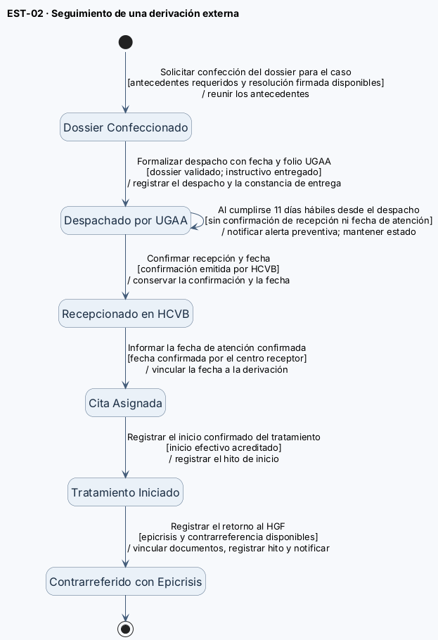

# Diagramas de estado

Este documento describe los estados y transiciones de dos clases del dominio de OncoTrace con ciclo de vida relevante: `AlertaSeguimiento` y `DossierDigitalDerivacion`. Los diagramas muestran las situaciones del objeto y los hechos que justifican cada cambio, no una secuencia de tareas de los funcionarios.

**Referencias:** [Criterios de aceptación](./07-criterios-aceptacion.md) · [Modelo de dominio](./08-modelo-dominio.md) · [Casos de uso](./09-casos-de-uso.md) · [Diagramas de secuencia](./10-diagramas-secuencia.md) · [Historias de usuario](./04-historias-usuario.md).

---

## EST-01 — Ciclo de vida de AlertaSeguimiento

- Clase del dominio: [`AlertaSeguimiento`](./08-modelo-dominio.md)
- Diagramas de secuencia relacionados: [DSS-01, DSS-02](./10-diagramas-secuencia.md)

Archivo fuente: [`./diagramas/estados-objetos.puml`](./diagramas/estados-objetos.puml)

### Descripción del ciclo de vida
La alerta comienza en **Pendiente** cuando se alcanza un umbral y no existe una alerta activa equivalente. El umbral depende del tipo: cinco días hábiles para una garantía GES pendiente; más de quince días corridos de inactividad; u once días hábiles desde el despacho sin recepción confirmada ni fecha de atención. La evaluación repetida no genera alertas duplicadas.

### Tabla de transiciones

| Estado origen | Evento | Guarda | Acción | Estado destino |
| :--- | :--- | :--- | :--- | :--- |
| **Inicial** | Se alcanza el umbral aplicable | [no hay alerta activa equivalente] | Crear alerta vinculada al caso y garantía/dossier | **Pendiente** |
| **Pendiente** | Registro de gestión por gestora | [gestora autorizada] | Conservar la acción de gestión registrada | **En gestión** |
| **Pendiente** | Registro de hito de cumplimiento | [cumplimiento de garantía GES] | Vincular hito que acredita cumplimiento | **Resuelta** |
| **En gestión** | Registro de hito de cumplimiento | [cumplimiento de garantía GES] | Vincular hito y cerrar alerta | **Resuelta** |
| **Pendiente** | Registro de causa documentada | [deja sin efecto la garantía GES] | Conservar motivo, fecha y responsable de cierre | **No aplica** |
| **En gestión** | Registro de causa documentada | [deja sin efecto la garantía GES] | Conservar motivo, fecha y responsable de cierre | **No aplica** |
| **Resuelta** | — | [estado terminal] | — | **—** |
| **No aplica** | — | [estado terminal] | — | **—** |

*Nota:* Las transiciones a **Resuelta** y **No aplica** con causa GES están limitadas a las alertas de garantías. Los criterios actuales no especifican una regla de cierre para alertas de inactividad o rezago.

---

## EST-02 — Ciclo de vida de DossierDigitalDerivacion

- Clase del dominio: [`DossierDigitalDerivacion`](./08-modelo-dominio.md)
- Diagramas de secuencia relacionados: [DSS-02](./10-diagramas-secuencia.md)

Archivo fuente: [`./diagramas/estados-objetos.puml`](./diagramas/estados-objetos.puml)

### Descripción del ciclo de vida
El dossier avanza por los seis estados definidos para HU-08. El registro de despacho requiere el dossier validado, la constancia de entrega anticipada del instructivo y los datos de despacho de UGAA. La recepción requiere confirmación emitida por HCVB. Si transcurren once días hábiles sin recepción ni fecha de atención, se genera una alerta y el dossier permanece en el estado despachado.

### Tabla de transiciones

| Estado origen | Evento | Guarda | Acción | Estado destino |
| :--- | :--- | :--- | :--- | :--- |
| **Inicial** | Confección del dossier | [antecedentes requeridos y resolución firmada] | Habilitar para validación y despacho UGAA | **Dossier Confeccionado** |
| **Dossier Confeccionado** | Validar y despachar por UGAA | [instructivo entregado + fecha y folio ingresados] | Registrar fecha y folio del despacho | **Despachado por UGAA** |
| **Despachado por UGAA** | Registrar confirmación de recepción | [confirmación emitida por HCVB] | Conservar confirmación y fecha de recepción | **Recepcionado en HCVB** |
| **Despachado por UGAA** | Evaluación de plazo transcurrido | [11 días hábiles sin recepción ni fecha] | Generar alerta preventiva (el estado no cambia) | **Despachado por UGAA** |
| **Recepcionado en HCVB** | Registrar fecha de atención confirmada | [cita asignada por centro receptor] | Vincular fecha de atención a la derivación | **Cita Asignada** |
| **Cita Asignada** | Confirmación de inicio de tratamiento | [antecedente de inicio disponible] | Registrar hito del caso oncológico | **Tratamiento Iniciado** |
| **Tratamiento Iniciado** | Incorporación de epicrisis y contra-referencia | [atención externa finalizada] | Vincular documentos y registrar hito de retorno | **Contrarreferido con Epicrisis** |
| **Contrarreferido con Epicrisis** | — | [estado terminal] | Continúa seguimiento en HGF | **—** |

---

## Fuente editable

El archivo PlantUML editable que contiene ambos diagramas de estado se encuentra adjunto en el repositorio:

- Archivo fuente unificado: [`./diagramas/estados-objetos.puml`](./diagramas/estados-objetos.puml)
