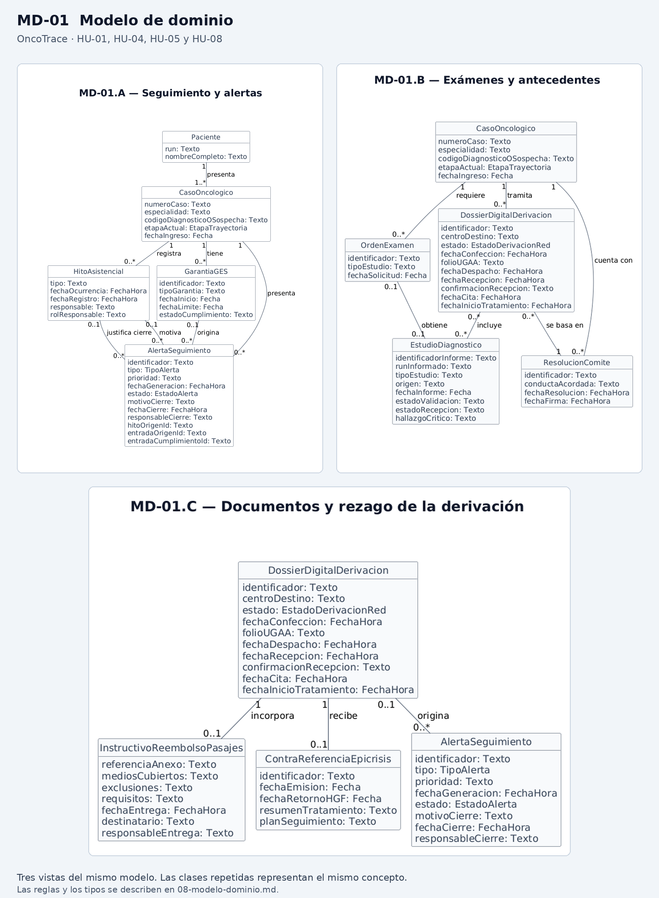

# Modelo de dominio

El modelo describe los conceptos del negocio necesarios para el conjunto completo de historias de OncoTrace (HU-01 a HU-11): seguimiento de casos, alertas, informes diagnósticos, derivaciones de red, valoración multidimensional, bitácora de acompañamiento, comités oncológicos colegiados, canales de usuario y sincronización ministerial. Sus clases y asociaciones sirven de referencia para los demás artefactos de la Entrega 2.

**Referencias:** [Criterios de aceptación](./07-criterios-aceptacion.md) · [Historias de usuario](./04-historias-usuario.md) · [Requisitos](./03-requisitos.md) · [Proceso TO-BE](./02-rediseno-to-be.md).

## Diagrama

**Identificador:** MD-01.

Archivo fuente: [modelo-dominio.puml](../diagramas/modelo-dominio.puml).

## Descripción de las clases

| Clase | Qué representa en el negocio | Atributos |
| :--- | :--- | :--- |
| `Paciente` | Persona atendida que tiene uno o más casos oncológicos registrados. | run, nombreCompleto |
| `CasoOncologico` | Caso cuyo seguimiento se realiza a lo largo de la trayectoria asistencial. | numeroCaso, especialidad, codigoDiagnosticoOSospecha, etapaActual, fechaIngreso |
| `HitoAsistencial` | Hecho del proceso de atención que se conserva en la línea de tiempo del caso. | tipo, fechaOcurrencia, fechaRegistro, responsable, rolResponsable |
| `GarantiaGES` | Garantía de oportunidad que se controla para un caso. | identificador, tipoGarantia, fechaInicio, fechaLimite, estadoCumplimiento |
| `AlertaSeguimiento` | Situación que requiere gestión por vencimiento próximo, inactividad, rezago de una derivación, búsqueda activa por no contactabilidad o punto de contacto pendiente. | identificador, tipo, prioridad, fechaGeneracion, estado, motivoCierre, fechaCierre, responsableCierre, hitoOrigenId, entradaOrigenId, entradaCumplimientoId |
| `OrdenExamen` | Solicitud de un estudio diagnóstico para un caso. | identificador, tipoEstudio, fechaSolicitud |
| `EstudioDiagnostico` | Estudio y su informe, cuya validación e identificación se comprueban antes de incorporarlo al caso. | identificadorInforme, runInformado, tipoEstudio, origen, fechaInforme, estadoValidacion, estadoRecepcion, hallazgoCritico |
| `ResolucionComite` | Conducta terapéutica acordada por el comité para un caso. | identificador, conductaAcordada, fechaResolucion, fechaFirma |
| `DossierDigitalDerivacion` | Expediente preparado para una derivación externa y su seguimiento hasta el retorno. | identificador, centroDestino, estado, fechaConfeccion, folioUGAA, fechaDespacho, fechaRecepcion, confirmacionRecepcion, fechaCita, fechaInicioTratamiento |
| `InstructivoReembolsoPasajes` | Ejemplar del instructivo asociado a un dossier, con su constancia de entrega. | referenciaAnexo, mediosCubiertos, exclusiones, requisitos, fechaEntrega, destinatario, responsableEntrega |
| `ContraReferenciaEpicrisis` | Antecedentes de cierre de la atención externa y del retorno al HGF. | identificador, fechaEmision, fechaRetornoHGF, resumenTratamiento, planSeguimiento |
| `EvaluacionMultidimensional` | Pauta de valoración integral aplicada al paciente para determinar riesgo biopsicosocial y derivaciones. | identificador, fechaEvaluacion, puntajeClinicoFuncional, puntajePsicoemocional, escalaZaritCuidador, nivelVulnerabilidad, profesionalEvaluador |
| `DominioValoracion` | Dimensión específica evaluada (clínico-funcional, psicoemocional, cuidador, social, espiritual, cognitivo). | tipoDominio, descripcionHallazgo, requiereDerivacion, especialidadDerivada |
| `EntradaBitacora` | Registro cronológico individual de contacto asistencial normado según el Journey Map de navegación, con programación del próximo contacto y soporte de adendas inmutables. | identificador, puntoContactoNormado, fechaContacto, canalContacto, interlocutor, motivoContacto, resumenInteraccion, acuerdosEstablecidos, responsableRegistro, estadoContacto, esAdenda, fechaProximoContacto, objetivoProximoContacto, entradaOriginalId |
| `CuidadorAutorizado` | Persona de apoyo acreditada con autorización formal vigente para consultar el estado del paciente en canales de autoatención. | runCuidador, nombreCompleto, parentesco, telefonoContacto, autorizacionVigente, fechaRegistroAutorizacion |
| `FichaPresentacionComite` | Expediente sintético consolidado automáticamente para la deliberación médica en el Comité Regional. | folioFicha, resumenClinico, etapificacionTNM, biopsiaValidadaReferencia, propuestaConducta, fechaGeneracion |
| `ActaComite` | Documento legal colegiado que formaliza el acuerdo terapéutico adoptado durante la sesión. | numeroActa, fechaSesion, quorumAsistentes, resolucionAcordada, estadoFirma |
| `FirmaElectronica` | Evidencia criptográfica de suscripción vinculante del acta por un médico especialista. | runFirmante, nombreFirmante, rolFirmante, estampaTiempo, hashIntegridad |
| `RegistroREM7` | Agrupación estadística mensual de decisiones terapéuticas para consolidación ministerial. | periodoMes, seccion, codigoPrestacion, totalCasos |
| `InteraccionCanalUsuario` | Sesión de consulta efectuada por el paciente o cuidador en canal público (tótem o chatbot), con verificación institucional y timeout de 30s. | identificadorSesion, canal, runUsuario, tipoUsuarioConsultante, runPacienteConsultado, autorizacionCuidadorVigente, metodoVerificacion, fechaHora, tipoConsulta, tiempoExpiracionSegundos |
| `TicketTriagePresencial` | Turno de atención clasificado por riesgo clínico o administrativo emitido hacia la consola del mesón UGCO. | numeroTurno, nivelPrioridad, motivoConsulta, fechaEmision, estadoAtencion |
| `RegistroIntercambioMINSAL` | Mensaje interoperable de seguimiento transmitido hacia la Plataforma Oncológica Central. | identificadorMensaje, tipoEvento, fechaEnvio, estadoSincronizacion, codigoRespuesta, folioTransaccionMINSAL |

`Texto`, `Fecha` y `FechaHora` describen el significado de los datos. Los atributos de fecha, confirmación o cierre se completan cuando ocurre el hecho correspondiente; no se exige que existan al crear el caso o el dossier.

## Asociaciones

Las multiplicidades se leen en ambos extremos. Por ejemplo, un paciente puede presentar varios casos, mientras que cada caso corresponde a un solo paciente.

| Asociación | Clases | Multiplicidades | Justificación |
| :--- | :--- | :--- | :--- |
| presenta | `Paciente` — `CasoOncologico` | Un paciente: 1..* casos. Un caso: 1 paciente. | Se representan personas que ya tienen casos registrados; una persona puede tener más de un caso. |
| registra | `CasoOncologico` — `HitoAsistencial` | Un caso: 0..* hitos. Un hito: 1 caso. | La línea de tiempo crece a medida que se registran hechos asistenciales. |
| tiene | `CasoOncologico` — `GarantiaGES` | Un caso: 0..* garantías. Una garantía: 1 caso. | Un caso puede tener varias garantías aplicables; no se exige una garantía para todo caso. |
| presenta | `CasoOncologico` — `AlertaSeguimiento` | Un caso: 0..* alertas. Una alerta: 1 caso. | Cada alerta debe permitir identificar el caso que requiere gestión. |
| origina | `GarantiaGES` — `AlertaSeguimiento` | Una garantía: 0..* alertas. Una alerta: 0..1 garantía. | Las alertas GES identifican su garantía. Las de inactividad, rezago, búsqueda activa o punto de contacto pendiente tienen otro origen. |
| requiere | `CasoOncologico` — `OrdenExamen` | Un caso: 0..* órdenes. Una orden: 1 caso. | El seguimiento distingue los exámenes solicitados de sus resultados recibidos. |
| obtiene | `OrdenExamen` — `EstudioDiagnostico` | Una orden: 0..1 estudio. Un estudio: 0..1 orden. | La orden puede estar pendiente. Un informe con identificación discrepante puede conservarse para revisión sin asociarlo todavía a una orden. |
| cuenta con | `CasoOncologico` — `ResolucionComite` | Un caso: 0..* resoluciones. Una resolución: 1 caso. | El caso puede existir antes de su presentación y puede recibir nuevas resoluciones durante su atención. |
| tramita | `CasoOncologico` — `DossierDigitalDerivacion` | Un caso: 0..* dossiers. Un dossier: 1 caso. | No todos los casos requieren derivación externa y un caso puede tener varias derivaciones. |
| se basa en | `DossierDigitalDerivacion` — `ResolucionComite` | Un dossier: 1 resolución. Una resolución: 0..* dossiers. | En el circuito de HU-08, la derivación se prepara a partir de una decisión del comité. |
| incluye | `DossierDigitalDerivacion` — `EstudioDiagnostico` | Un dossier: 0..* estudios. Un estudio: 0..* dossiers. | Los informes se reúnen según los antecedentes requeridos y pueden utilizarse en más de una derivación del mismo caso. |
| incorpora | `DossierDigitalDerivacion` — `InstructivoReembolsoPasajes` | Un dossier: 0..1 instructivo. Un instructivo entregado: 1 dossier. | La asociación permite distinguir el dossier preparado de aquel que ya tiene adjunto el instructivo y su constancia de entrega. |
| recibe | `DossierDigitalDerivacion` — `ContraReferenciaEpicrisis` | Un dossier: 0..1 contrarreferencia con epicrisis. Una contrarreferencia: 1 dossier. | El retorno se incorpora cuando finaliza la atención externa. |
| origina | `DossierDigitalDerivacion` — `AlertaSeguimiento` | Un dossier: 0..* alertas. Una alerta: 0..1 dossier. | Una alerta de rezago identifica la derivación que requiere seguimiento. |
| justifica cierre | `HitoAsistencial` — `AlertaSeguimiento` | Un hito: 0..* alertas. Una alerta: 0..1 hito de cumplimiento. | Cuando una garantía se cumple, se conserva el hito que permite resolver su alerta. |
| motiva | `HitoAsistencial` — `AlertaSeguimiento` | Un hito: 0..* alertas. Una alerta: 0..1 hito de origen. | La alerta de punto de contacto pendiente identifica el hito normado que la abrió. |
| registra | `CasoOncologico` — `EvaluacionMultidimensional` | Un caso: 0..* evaluaciones. Una evaluación: 1 caso. | El caso puede recibir una evaluación basal y revaluaciones periódicas. |
| evalúa | `EvaluacionMultidimensional` — `DominioValoracion` | Una evaluación: 1..* dominios. Un dominio evaluado: 1 evaluación. | La valoración se compone obligatoriamente de los dominios biopsicosociales normados. |
| documenta | `CasoOncologico` — `EntradaBitacora` | Un caso: 0..* entradas. Una entrada: 1 caso. | La bitácora registra cronológicamente cada interacción y punto de contacto. |
| rectifica | `EntradaBitacora` — `EntradaBitacora` | Una entrada original: 0..* adendas. Una adenda: 0..1 entrada original. | Vincula la corrección con la entrada que rectifica; la entrada original permanece intacta. |
| motiva | `EntradaBitacora` — `AlertaSeguimiento` | Una entrada: 0..* alertas. Una alerta: 0..1 entrada de origen. | La alerta de búsqueda activa identifica la tercera entrada fallida que la abrió. |
| resuelve | `EntradaBitacora` — `AlertaSeguimiento` | Una entrada: 0..* alertas. Una alerta: 0..1 entrada de cumplimiento. | Cuando el contacto restablece la actividad, se conserva la entrada que resolvió la alerta. |
| sustenta | `CasoOncologico` — `FichaPresentacionComite` | Un caso: 0..* fichas. Una ficha: 1 caso. | Un caso puede presentarse en una o más ocasiones ante el comité. |
| presenta a | `FichaPresentacionComite` — `ActaComite` | Una ficha: 0..1 acta. Un acta: 1 ficha. | Cada presentación a sesión de comité concluye formalmente en su respectiva acta. |
| suscribe con | `ActaComite` — `FirmaElectronica` | Un acta: 1..* firmas. Una firma: 1 acta. | Todo dictamen colegiado requiere la firma de los médicos especialistas asistentes. |
| tributa a | `ActaComite` — `RegistroREM7` | Un acta: 0..* registros. Un registro REM 7: 0..* actas. | Las decisiones terapéuticas de las actas alimentan los consolidados estadísticos mensuales. |
| autoriza | `Paciente` — `CuidadorAutorizado` | Un paciente: 0..1 cuidador. Un cuidador: 1 paciente. | Respalda la acreditación y vigencia legal para consultar información en canales de autoatención. |
| realiza consulta en | `CuidadorAutorizado` — `InteraccionCanalUsuario` | Un cuidador: 0..* interacciones. Una interacción: 0..1 cuidador. | Registra las consultas efectuadas por el cuidador previa validación de autorización. |
| consulta en | `CasoOncologico` — `InteraccionCanalUsuario` | Un caso: 0..* interacciones. Una interacción: 0..1 caso. | Los pacientes y cuidadores consultan el avance de su caso en tótems o chatbots institucionales. |
| emite | `InteraccionCanalUsuario` — `TicketTriagePresencial` | Una interacción: 0..1 ticket. Un ticket: 1 interacción. | Una consulta presencial desorientada o con síntomas genera un turno categorizado. |
| reporta a | `CasoOncologico` — `RegistroIntercambioMINSAL` | Un caso: 0..* registros MINSAL. Un registro: 1 caso. | Cada hito clínico genera un mensaje interoperable de sincronización ministerial. |

## Decisiones de modelado

- Se mantienen conceptos ya usados en la Entrega 1 y se incorporan `HitoAsistencial` y `AlertaSeguimiento` para representar explícitamente la línea de tiempo y las alertas de las historias seleccionadas.

- Gestor/a, TENS, funcionario/a de UGAA y médico tratante se representan como roles de quienes participan en el proceso, no como clases distintas. Los atributos de responsabilidad conservan quién registró un hecho o una entrega. Los permisos y la auditoría se especifican en RNF-03 y REQ-DER-01.

- Se usan asociaciones simples. No se necesita herencia para distinguir los informes en este alcance: su tipo y origen permiten describirlos. No se usa agregación ni composición, porque las historias no establecen dependencia de eliminación entre estos registros.

- Se conserva `EstudioDiagnostico` como concepto común para el estudio y su informe. La relación con `OrdenExamen` representa un resultado consolidado por orden, como en el modelo previo. Las discrepancias se conservan para revisión antes de establecer la asociación definitiva.

- `InstructivoReembolsoPasajes` representa el ejemplar asociado a una derivación y su entrega al paciente o cuidador. La plantilla institucional del Anexo 6 puede ser común; la constancia de entrega corresponde a cada dossier.

- `ContraReferenciaEpicrisis` reúne los antecedentes de retorno vinculados a una derivación, conservando el concepto usado en la Entrega 1.

### Tipos y estados del negocio

| Tipo | Valores o significado |
| :--- | :--- |
| `EtapaTrayectoria` | Sospecha; Confirmación diagnóstica; Etapificación; Tratamiento; Rehabilitación; Cuidados paliativos y alivio del dolor; Seguimiento y sobrevivientes; Alta y contrarreferencia. |
| `TipoAlerta` | Proximidad de vencimiento GES; Riesgo de Inactividad/Abandono; Rezago de derivación; Búsqueda activa por no contactabilidad; Punto de contacto pendiente. |
| `EstadoAlerta` | Pendiente; En gestión; Resuelta; No aplica. Pendiente identifica una alerta generada que aún no tiene una gestión registrada; los otros estados se aplican según HU-04 y HU-03. |
| `EstadoDerivacionRed` | Dossier Confeccionado; Despachado por UGAA; Recepcionado en HCVB; Cita Asignada; Tratamiento Iniciado; Contrarreferido con Epicrisis. |
| `NivelVulnerabilidad` | Bajo; Medio; Alto. Clasificación resultante del índice de vulnerabilidad asistencial global que pondera el desempeño clínico funcional (ECOG 0-4), riesgo psicosocial y sobrecarga del cuidador (Zarit > 56). |
| `EstadoContactoBitacora` | Efectivo; No contactable. Registra la efectividad del contacto asistencial en cada entrada de la bitácora. |
| `PuntoContactoNormado` | P1 Ingreso/Sospecha inicial; P2 Post-confirmación diagnóstica con IPD; P3 Etapificación/Post-resolución de comité; P4 Alta de hospitalización o cirugía; P5 Fin del tratamiento activo y retorno a la vida cotidiana; P6 Derivación a otro establecimiento de la red; No normado. Identifica el punto de contacto obligatorio del Journey Map al que corresponde una entrada de la bitácora. |
| `EstadoSincronizacionMINSAL` | Pendiente de confirmación; Sincronizado; Pendiente de reintento. Modela el ciclo de vida de los mensajes de intercambio ministerial (HU-11). |

### Correspondencia entre hitos y puntos de contacto

La obligación de contacto se activa cuando el `tipo` de un `HitoAsistencial` coincide, sin distinguir mayúsculas, con alguno de estos textos:

| Punto | Textos del tipo de hito que activan la obligación |
| :--- | :--- |
| **P1** Ingreso / Sospecha inicial | ingreso de sospecha; recepción de interconsulta; primera consulta; derivación desde urgencia con sospecha |
| **P2** Post-confirmación diagnóstica con IPD | confirmación diagnóstica; confirmación histológica; notificación diagnóstica; notificación GES; entrega de IPD; informe de biopsia confirmatoria; diagnóstico confirmado |
| **P3** Etapificación / Post-resolución de comité | resolución de comité |
| **P4** Alta de hospitalización o cirugía | alta hospitalaria; intervención quirúrgica; cirugía |
| **P5** Fin del tratamiento activo y retorno a la vida cotidiana | término de quimioterapia; término de radioterapia; ingreso a seguimiento; sobrevivientes |
| **P6** Derivación a otro establecimiento de la red | despacho de derivación |

Si el tipo de hito no coincide con ninguno de estos textos, no se abre obligación.

### Restricciones que complementan las multiplicidades

- El comité se registra como un hito; no es un valor de `EtapaTrayectoria`. Firmar su resolución no cambia por sí solo la etapa del caso.

- Cada alerta GES debe vincularse a una garantía del mismo caso. Cada alerta de rezago debe vincularse a un dossier del mismo caso. Una alerta de inactividad se vincula directamente al caso y no necesita garantía ni dossier de origen.

- Una gestión registrada no resuelve una garantía pendiente. El estado Resuelta requiere el hito de cumplimiento de la garantía o el contacto que restablece la actividad del caso. El estado No aplica requiere una causa documentada, fecha y responsable del cierre.

- Al transicionar a **Resuelta** o **No aplica**, `AlertaSeguimiento` registra en `fechaCierre` la fecha y hora del cambio. La visibilidad de 14 horas de una alerta **Resuelta** en el panel general se calcula desde ese valor; transcurrido ese plazo, la alerta solo queda consultable en la ficha del caso (HU-04 / ESC-06).

- Un informe incorporado debe estar validado y vinculado a una orden del caso cuyo paciente coincida con el RUN informado. Si hay discrepancia, se conserva para revisión y no cuenta como examen recibido. Un informe pendiente de validación tampoco cuenta como recibido.

- Los estudios y la resolución incluidos en un dossier deben corresponder al mismo caso. La confección exige los antecedentes de HU-08-ESC-01 y la resolución firmada; las multiplicidades opcionales no eliminan esos prerrequisitos.

- Para el despacho a HCVB deben existir la fecha, el folio UGAA, el instructivo del Anexo 6 y su constancia de entrega anticipada, según HU-08-ESC-02. La recepción requiere una confirmación del centro receptor; no se deduce del despacho. Una cita asignada tampoco acredita el inicio del tratamiento.

- La contrarreferencia con epicrisis se asocia al dossier cuando se registra el retorno al HGF, según HU-08-ESC-06.

- El conteo de intentos fallidos de contacto se calcula sobre las **entradas de acompañamiento** vinculadas al caso (no adenda y con punto de contacto normado) cuyo `estadoContacto = 'No contactable'`, en orden cronológico. Un contacto `Efectivo` reinicia la racha y las adendas no la alteran. Las entradas de gestión de alertas de HU-04, que no declaran punto normado, no cuentan como intento ni reinician la racha. Al detectarse tres intentos fallidos consecutivos, el sistema genera una única `AlertaSeguimiento` de búsqueda activa, vinculada a la tercera entrada (`entradaOrigenId`), para activar el protocolo de rescate y búsqueda activa con APS (HU-03).

- El indicador de contactabilidad del caso se deriva de la última **entrada de acompañamiento** (no adenda y con punto de contacto normado): `Efectivo` indica contacto vigente y `No contactable` indica que se perdió. Las adendas y las entradas de gestión de alertas de HU-04 no modifican ese indicador.

- Una adenda se vincula a la entrada original mediante `entradaOriginalId`; no la reemplaza ni la elimina. La entrada original permanece intacta y la adenda conserva usuario, fecha y hora, y motivo de la enmienda (HU-03 / ESC-04).

- La alerta de punto de contacto pendiente se abre cuando un hito de la correspondencia anterior lleva más de dos días hábiles completos sin una entrada del punto con fecha igual o posterior al hito. Se vincula al `hitoOrigenId` y se resuelve con la entrada del punto, que queda registrada en `entradaCumplimientoId`. No se duplica mientras exista una alerta activa para el mismo hito.

- La alerta de búsqueda activa se resuelve con un contacto `Efectivo` o con la acreditación de la respuesta de APS; el contacto que resuelve queda registrado en `entradaCumplimientoId`.

- Los registros en `RegistroIntercambioMINSAL` inician en `Pendiente de confirmación` al emitirse el mensaje hacia la plataforma nacional, pasan a `Sincronizado` al recibir el acuse satisfactorio con folio de transacción MINSAL, o a `Pendiente de reintento` ante indisponibilidad o errores de formato para permitir su reprocesamiento auditado (HU-11).

## Relación con las historias de usuario (HU-01 a HU-11)

| Historia | Conceptos principales del modelo de dominio |
| :--- | :--- |
| [HU-01](./04-historias-usuario.md#hu-01) | `Paciente`, `CasoOncologico`, `HitoAsistencial`, `ResolucionComite`. |
| [HU-02](./04-historias-usuario.md#hu-02) | `CasoOncologico`, `EvaluacionMultidimensional`, `DominioValoracion`. |
| [HU-03](./04-historias-usuario.md#hu-03) | `CasoOncologico`, `EntradaBitacora`, `HitoAsistencial`, `AlertaSeguimiento`. |
| [HU-04](./04-historias-usuario.md#hu-04) | `CasoOncologico`, `GarantiaGES`, `AlertaSeguimiento`, `HitoAsistencial`. |
| [HU-05](./04-historias-usuario.md#hu-05) | `CasoOncologico`, `OrdenExamen`, `EstudioDiagnostico`. |
| [HU-06](./04-historias-usuario.md#hu-06) | `CasoOncologico`, `FichaPresentacionComite`, `EstudioDiagnostico`. |
| [HU-07](./04-historias-usuario.md#hu-07) | `CasoOncologico`, `ActaComite`, `FirmaElectronica`, `RegistroREM7`, `ResolucionComite`. |
| [HU-08](./04-historias-usuario.md#hu-08) | `CasoOncologico`, `ResolucionComite`, `DossierDigitalDerivacion`, `EstudioDiagnostico`, `InstructivoReembolsoPasajes`, `ContraReferenciaEpicrisis`, `AlertaSeguimiento`. |
| [HU-09](./04-historias-usuario.md#hu-09) | `Paciente`, `CuidadorAutorizado`, `InteraccionCanalUsuario`, `CasoOncologico`. |
| [HU-10](./04-historias-usuario.md#hu-10) | `Paciente`, `InteraccionCanalUsuario`, `TicketTriagePresencial`. |
| [HU-11](./04-historias-usuario.md#hu-11) | `CasoOncologico`, `RegistroIntercambioMINSAL`, `HitoAsistencial`. |
