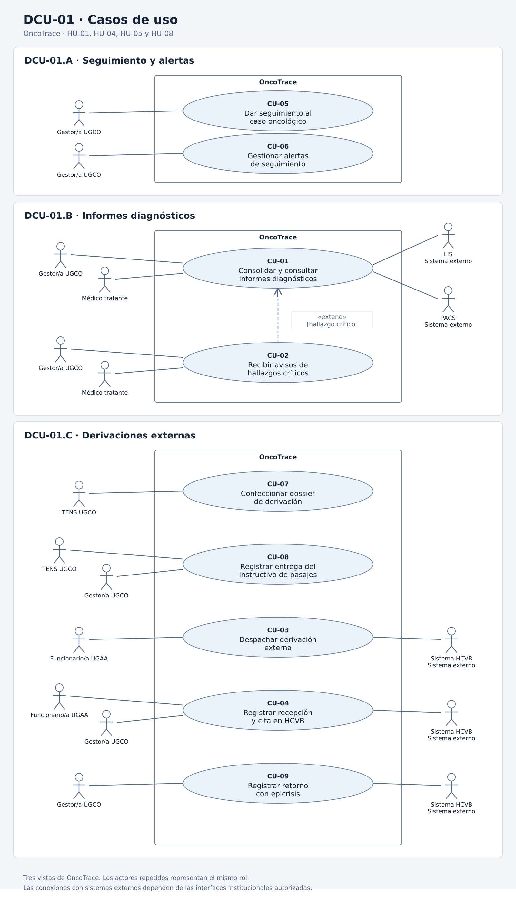

# Casos de uso

Este documento describe los objetivos de los actores que participan en las historias **HU-01**, **HU-04**, **HU-05** y **HU-08** de OncoTrace. Su alcance se basa en los [criterios de aceptación](./07-criterios-aceptacion.md) y el [modelo de dominio](./08-modelo-dominio.md) de la Entrega 2.

**Requisitos de origen:** RF-01, RF-04, RF-05 y RF-08 de [03-requisitos.md](./03-requisitos.md).

---

## Actores del sistema

| Actor | Tipo | Descripción |
| :--- | :--- | :--- |
| **Gestor/a UGCO** | Humano | Consulta y actualiza el seguimiento del caso dentro de sus permisos, gestiona alertas, consulta informes diagnósticos y coordina el seguimiento de las derivaciones. |
| **Médico tratante** | Humano | Consulta informes diagnósticos y recibe avisos prioritarios de hallazgos críticos para su evaluación clínica. |
| **TENS UGCO** | Humano | Confecciona el dossier digital de derivación y puede registrar la entrega anticipada del instructivo de pasajes del Anexo 6. |
| **Funcionario/a UGAA** | Humano | Valida el dossier, formaliza el despacho y registra la confirmación de recepción o de cita emitida por el centro receptor cuando corresponde. |
| **LIS** | Sistema externo | Proporciona informes de laboratorio y anatomía patológica junto con su estado de validación. |
| **PACS** | Sistema externo | Proporciona informes de imagenología junto con su estado de validación. |
| **Sistema HCVB** | Sistema externo | Representa al sistema del Hospital Carlos Van Buren en el intercambio de antecedentes de la derivación, confirmaciones de recepción, fechas de atención y documentos de retorno, según las interfaces institucionales habilitadas y autorizadas. |

Los actores humanos deben autenticarse y contar con los permisos de su rol. OncoTrace registra los accesos y las operaciones sujetos a auditoría conforme a RNF-03 y REQ-DER-01.

La comunicación con LIS y PACS se ajusta a RNF-04. El intercambio puede realizarse mediante HL7 FHIR o API REST según las interfaces disponibles en el hospital. Si no hay una interfaz habilitada con HCVB, UGAA puede registrar la confirmación de recepción o de cita emitida por el centro receptor. El retorno se registra cuando la gestora incorpora la epicrisis y la contrarreferencia.

En las historias seleccionadas, el paciente o cuidador recibe orientación y el instructivo de pasajes a través del personal de la UGCO. La autoatención de HU-09 y el intercambio con MINSAL de HU-11 quedan fuera del alcance de este diagrama.

---

- **Médico integrante del Comité Oncológico:** Especialista que participa en la sesión colegiada para deliberar la conducta terapéutica consensuada y suscribir el acta con firma electrónica.
- **Paciente y cuidador:** Personas que consultan el avance de su proceso asistencial mediante canales de autoatención (tótem) o asistentes interactivos (chatbot de derechos y triage).
- **Sistema Central MINSAL (Sistema externo):** Plataforma nacional del Ministerio de Salud con la que OncoTrace intercambia datos estructurados de seguimiento oncológico.

## Diagrama de casos de uso

**Identificador:** DCU-01.

**Archivo fuente:** [casos-de-uso.puml](../diagramas/casos-de-uso.puml).

El diagrama se organiza en tres vistas: seguimiento y alertas, informes diagnósticos y derivaciones externas. En cada vista, el rectángulo delimita OncoTrace y los actores se ubican fuera. Cuando un actor aparece en más de una vista, representa el mismo rol.

---

## Casos de uso y su origen

| ID | Caso de uso | Actor principal | Historia de origen | Escenarios de aceptación |
| :--- | :--- | :--- | :--- | :--- |
| **CU-01** | Consolidar y consultar informes diagnósticos | Gestor/a UGCO y médico tratante | [HU-05](./04-historias-usuario.md#hu-05) | HU-05-ESC-01, HU-05-ESC-03 y HU-05-ESC-04 |
| **CU-02** | Recibir avisos de hallazgos críticos | Gestor/a UGCO y médico tratante | [HU-05](./04-historias-usuario.md#hu-05) | HU-05-ESC-02 |
| **CU-03** | Despachar derivación externa | Funcionario/a UGAA | [HU-08](./04-historias-usuario.md#hu-08) | HU-08-ESC-02 |
| **CU-04** | Registrar recepción y cita en HCVB | Funcionario/a UGAA y gestor/a UGCO | [HU-08](./04-historias-usuario.md#hu-08) | HU-08-ESC-03 y HU-08-ESC-04 |
| **CU-05** | Dar seguimiento al caso oncológico | Gestor/a UGCO | [HU-01](./04-historias-usuario.md#hu-01) | HU-01-ESC-01 a HU-01-ESC-05 |
| **CU-06** | Gestionar alertas de seguimiento | Gestor/a UGCO | [HU-04](./04-historias-usuario.md#hu-04) y [HU-08](./04-historias-usuario.md#hu-08) | HU-04-ESC-01 a HU-04-ESC-07 y HU-08-ESC-05 |
| **CU-07** | Confeccionar dossier de derivación | TENS UGCO | [HU-08](./04-historias-usuario.md#hu-08) | HU-08-ESC-01 |
| **CU-08** | Registrar entrega del instructivo de pasajes | Gestor/a UGCO o TENS UGCO | [HU-08](./04-historias-usuario.md#hu-08) | HU-08-ESC-02 |
| **CU-09** | Registrar retorno con epicrisis | Gestor/a UGCO | [HU-08](./04-historias-usuario.md#hu-08) | HU-08-ESC-06 |
| **CU-10** | Aplicar evaluación multidimensional y estratificar riesgo | Gestor/a UGCO | [HU-02](./04-historias-usuario.md#hu-02) | HU-02-ESC-01 a HU-02-ESC-03 |
| **CU-11** | Registrar interacción en bitácora de acompañamiento | Gestor/a UGCO y TENS UGCO | [HU-03](./04-historias-usuario.md#hu-03) | HU-03-ESC-01 a HU-03-ESC-04 |
| **CU-12** | Generar ficha de presentación a comité | Gestor/a UGCO y médico tratante | [HU-06](./04-historias-usuario.md#hu-06) | HU-06-ESC-01 a HU-06-ESC-03 |
| **CU-13** | Registrar acta de comité, firma y consolidar REM 7 | Médico integrante del comité | [HU-07](./04-historias-usuario.md#hu-07) | HU-07-ESC-01 a HU-07-ESC-03 |
| **CU-14** | Consultar estado en tótem de autoatención | Paciente y cuidador principal | [HU-09](./04-historias-usuario.md#hu-09) | HU-09-ESC-01 a HU-09-ESC-05 |
| **CU-15** | Orientar derechos y clasificar triage presencial | Paciente, cuidador y gestor/a UGCO | [HU-10](./04-historias-usuario.md#hu-10) | HU-10-ESC-01 a HU-10-ESC-03 |
| **CU-16** | Monitorear sincronización con plataforma MINSAL | Gestor/a UGCO y Sistema MINSAL | [HU-11](./04-historias-usuario.md#hu-11) | HU-11-ESC-01 a HU-11-ESC-03 |

---

## Relaciones entre los casos de uso

- **CU-02 extiende CU-01.** El punto de extensión es la incorporación del informe. El aviso se genera al incorporar un informe validado de anatomía patológica cuyo RUN permite identificar inequívocamente al paciente y que contiene un hallazgo de malignidad o un valor crítico informado por el sistema de origen. OncoTrace avisa al médico tratante y a la gestora, e identifica el caso y el informe. La flecha `<<extend>>` va de CU-02 a CU-01.
- **CU-04 es independiente de CU-03.** La recepción y la cita se registran después del despacho y pueden confirmarse en momentos distintos.
- **CU-08 es independiente de CU-03.** La entrega del instructivo se registra por anticipado. Para formalizar el despacho a HCVB, CU-03 verifica que exista la constancia de entrega. Esa constancia es una precondición del despacho.

---

- **CU-12 se incluye en CU-13 (`<<include>>`).** Para formalizar el acta y deliberar en comité (CU-13), la sesión colegiada requiere la disponibilidad de la Ficha Resumen de Presentación generada y consolidada previamente (CU-12).
- **CU-15 extiende a CU-14 (`<<extend>>`).** El paciente que consulta en el tótem de autoatención (CU-14) puede solicitar orientación interactiva de derechos o triage presencial (CU-15) si presenta desorientación o síntomas de descompensación asistencial.
- **CU-11 actualiza los hitos de CU-05.** Cada punto de contacto normado registrado en la bitácora impacta cronológicamente la línea de tiempo del caso oncológico.

## Reglas de consistencia con otros artefactos

1. **Seguimiento del caso (CU-05).** El caso sigue las ocho etapas del modelo de dominio. La resolución firmada del comité se registra como hito. El cambio a la etapa de tratamiento requiere que se registre el inicio efectivo del tratamiento. El registro de cualquier hito asistencial exige consistencia temporal: su fecha de ocurrencia no puede ser posterior a la fecha actual ni anterior a la del último hito registrado en el caso, rechazando cualquier incongruencia cronológica.
2. **Alertas de seguimiento (CU-06).** OncoTrace evalúa los umbrales definidos en el documento 07 para vencimientos GES, inactividad y rezago de derivación. Registrar una gestión de seguimiento no acredita el cumplimiento de una garantía GES. En HU-08, si al cumplirse once días hábiles desde el despacho no hay recepción confirmada ni fecha de atención, se genera una alerta preventiva y la derivación permanece en estado **Despachado por UGAA**.
3. **Validación e identificación de informes (CU-01 y CU-02).** Si el RUN no permite asociar el informe al paciente con certeza, OncoTrace lo conserva como una excepción pendiente de revisión, registra la discrepancia para auditoría y mantiene el examen pendiente. Si el informe sigue pendiente de validación en LIS o PACS, el examen permanece pendiente de recibir un informe validado.
4. **Preparación y despacho (CU-07, CU-08 y CU-03).** TENS confecciona el dossier con los antecedentes requeridos, incluida el acta firmada del comité. Para el despacho a HCVB debe constar la entrega anticipada del instructivo del Anexo 6 al paciente o cuidador. Al formalizar el despacho, UGAA registra la fecha y el folio.
5. **Recepción, cita y retorno (CU-04 y CU-09).** El despacho deja la derivación en estado **Despachado por UGAA**. Para pasar a **Recepcionado en HCVB**, se registra la confirmación emitida por el centro receptor. La fecha de atención confirmada permite registrar **Cita Asignada**. El inicio del tratamiento se registra cuando se confirma que ocurrió. Al retorno, la gestora incorpora la epicrisis y la contrarreferencia, las vincula al caso y deja un hito en la línea de tiempo.
6. **Evaluación multidimensional y bitácora (CU-10 y CU-11).** La valoración inicial exige el registro del estado funcional basal ECOG y la estratificación de vulnerabilidad biopsicosocial. Los 6 puntos de contacto normados deben registrarse cronológicamente en la bitácora según el Journey Map; el rezago superior a 48 horas hábiles tras alcanzar un hito obligatorio sin registrar el contacto genera una alerta preventiva a la gestora en CU-06. La bitácora preserva el principio de inmutabilidad mediante notas de adenda para cualquier rectificación posterior.
7. **Comités oncológicos y REM 7 (CU-12 y CU-13).** La ficha de presentación exige informe de biopsia validado en LIS/Pathology. El acta firmada electrónicamente por los especialistas es legalmente vinculante, inmutable tras la sesión (Ley N° 20.584 y DS N° 29), y aporta la información estadística consolidada para el REM 7 ministerial.
8. **Autoatención, triage e interoperabilidad (CU-14, CU-15 y CU-16).** La consulta en tótem de autoatención (CU-14) exige autenticación mediante factor autorizado por el hospital (cédula más factor secundario/código de verificación; RUN o cédula solos no bastan) y verifica la autorización vigente si quien consulta es un cuidador. El tótem despliega únicamente los 4 estados macro en lenguaje claro (*En proceso en laboratorio, Informe listo para revisión médica, Caso agendado en comité, Próxima cita médica programada*), omite términos histopatológicos reservados (Ley N° 20.584) y cierra la sesión automáticamente tras 30 segundos de inactividad o mediante el botón Salir. Las consultas de triage con dolor o urgencia generan tickets prioritarios sincronizados con el mesón gestor. La sincronización MINSAL reporta eventos en HL7 FHIR manteniendo encolamiento de reintentos ante fallas técnicas.
