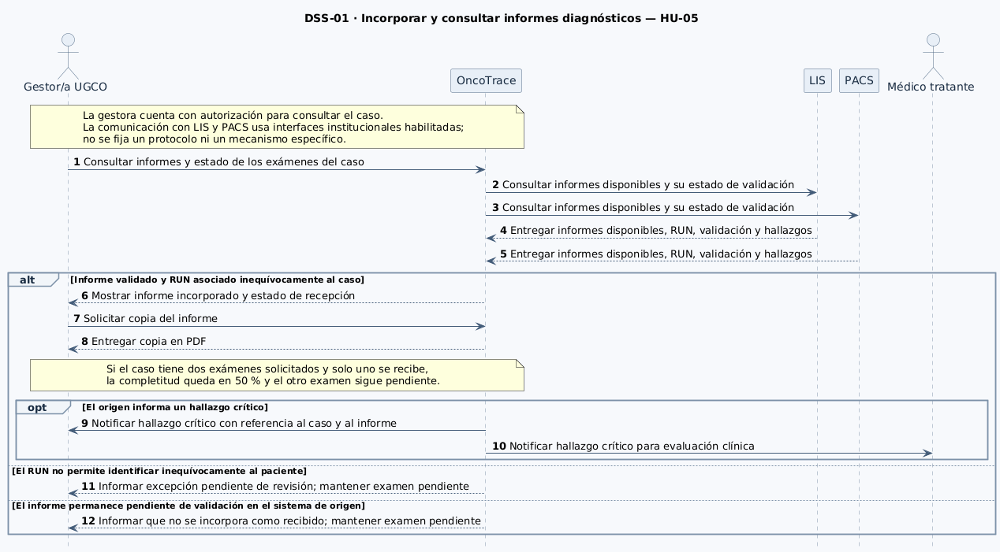
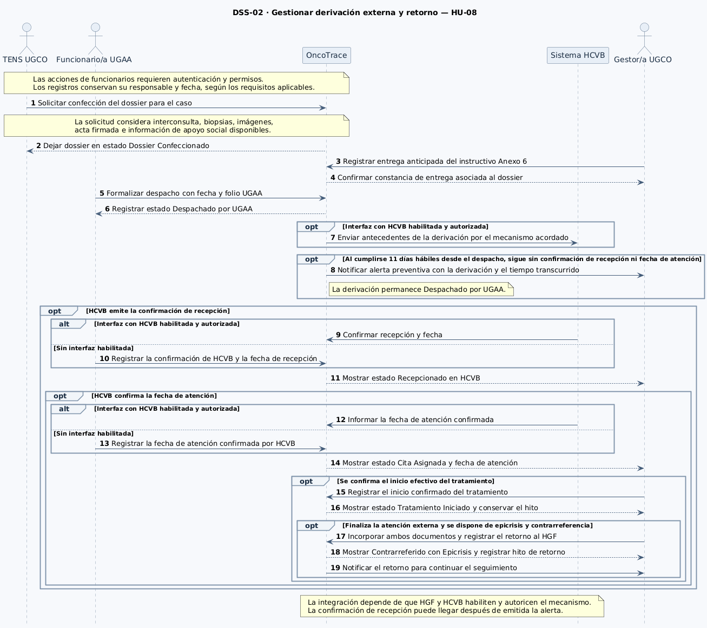
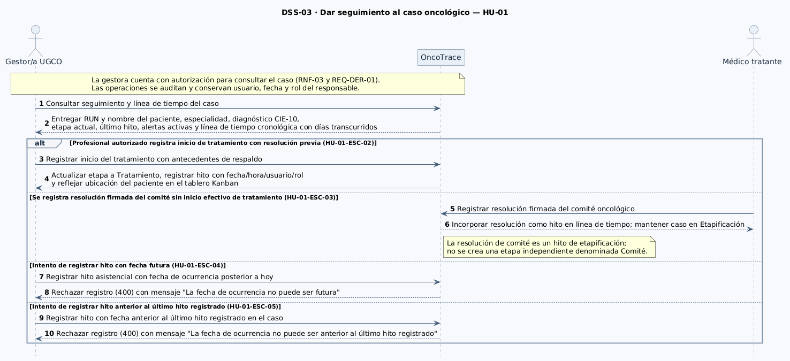
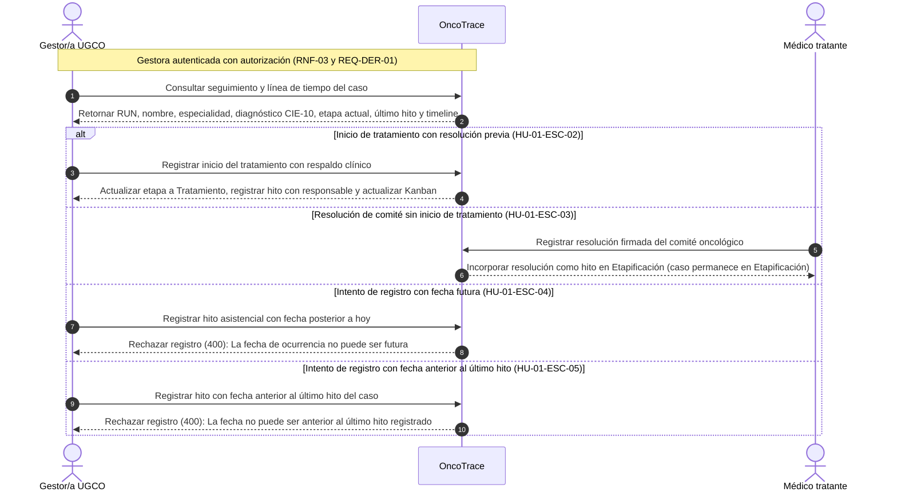
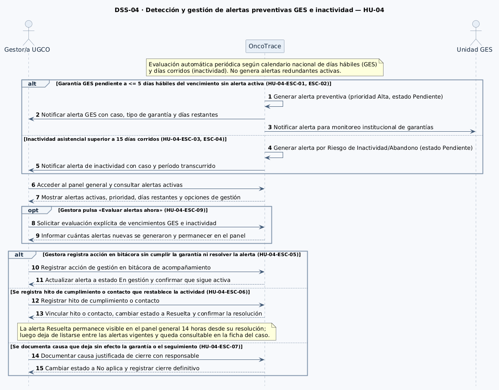

# Diagramas de secuencia del sistema

Este documento describe las interacciones de los actores con OncoTrace para las historias de la Entrega 2 (**HU-01**, **HU-04**, **HU-05** y **HU-08**). Los diagramas representan el sistema como una caja negra y muestran los mensajes y resultados que observan sus participantes.

**Referencias:** [Criterios de aceptación](./07-criterios-aceptacion.md) · [Modelo de dominio](./08-modelo-dominio.md) · [Casos de uso](./09-casos-de-uso.md) · [Historias de usuario](./04-historias-usuario.md).

---

## DSS-01 — Incorporar y consultar informes diagnósticos

- **Casos de uso:** [CU-01 y CU-02](./09-casos-de-uso.md#casos-de-uso-y-su-origen).
- **Historia:** [HU-05](./04-historias-usuario.md#hu-05).
- **Sistemas externos:** LIS y PACS.



**Archivo fuente:** [diagramas-secuencia.puml](../diagramas/diagramas-secuencia.puml).

La gestora consulta los informes y el estado de los exámenes del caso. OncoTrace obtiene los antecedentes disponibles de LIS y PACS a través de las interfaces institucionales habilitadas. Si el informe está validado y el RUN permite asociarlo inequívocamente al caso, OncoTrace lo incorpora y deja disponible su copia en PDF. En HU-05-ESC-01, al recibir uno de los dos exámenes solicitados, la completitud queda en 50 % y el otro examen sigue pendiente.

### Variantes representadas

- **`alt` — Validación e identificación.** Si el RUN no permite identificar al paciente con certeza, el informe queda como excepción pendiente de revisión, se registra la discrepancia para auditoría y el examen sigue pendiente. Si el informe aún no está validado en el sistema de origen, se mantiene pendiente la recepción del resultado validado.
- **`opt` — Hallazgo crítico.** Si se incorpora un informe validado de anatomía patológica con un hallazgo de malignidad o un valor crítico informado por el origen, OncoTrace notifica al médico tratante y a la gestora. El aviso permite identificar el caso y el informe.

---

## DSS-02 — Gestionar derivación externa y retorno

- **Casos de uso:** [CU-03, CU-04, CU-06, CU-07, CU-08 y CU-09](./09-casos-de-uso.md#casos-de-uso-y-su-origen).
- **Historia:** [HU-08](./04-historias-usuario.md#hu-08).
- **Sistema externo:** Sistema del Hospital Carlos Van Buren (HCVB), sujeto a la habilitación y autorización de la interfaz institucional.



**Archivo fuente:** [diagramas-secuencia.puml](../diagramas/diagramas-secuencia.puml).

TENS solicita la confección del dossier. En el flujo representado, la gestora registra la entrega anticipada del instructivo de pasajes del Anexo 6. UGAA valida los antecedentes del dossier y, con la constancia de entrega registrada, formaliza el despacho con su fecha y folio. La derivación queda en estado **Despachado por UGAA**.

### Variantes representadas

- **`opt` — Envío de antecedentes.** OncoTrace envía los antecedentes a HCVB por el mecanismo acordado cuando la interfaz institucional está habilitada y autorizada.
- **`opt` — Alerta de seguimiento.** Si al cumplirse once días hábiles desde el despacho siguen sin registrarse la confirmación de recepción y la fecha de atención, OncoTrace genera una alerta preventiva que identifica la derivación y el tiempo transcurrido. El dossier permanece en estado **Despachado por UGAA**. La confirmación puede llegar después de la alerta.
- **`opt` y `alt` — Recepción y cita.** La derivación pasa a **Recepcionado en HCVB** al registrar la confirmación emitida por ese hospital. La fecha de atención confirmada se registra por separado y permite pasar a **Cita Asignada**. Con una interfaz habilitada, los antecedentes se reciben desde el sistema de HCVB. Si la interfaz no está habilitada, UGAA registra la información confirmada por el centro receptor.
- **`opt` — Inicio del tratamiento y retorno.** El estado **Tratamiento Iniciado** requiere confirmar el inicio efectivo. Cuando finaliza la atención externa, la gestora incorpora la epicrisis y la contrarreferencia. OncoTrace registra **Contrarreferido con Epicrisis**, deja un hito en la línea de tiempo y notifica a la gestora para continuar el seguimiento.

---

## DSS-03 — Dar seguimiento al caso oncológico

- **Caso de uso:** [CU-05](./09-casos-de-uso.md#casos-de-uso-y-su-origen).
- **Historia:** [HU-01](./04-historias-usuario.md#hu-01).
- **Actores participantes:** Gestor/a UGCO y médico tratante.



**Archivo fuente:** [diagramas-secuencia.puml](../diagramas/diagramas-secuencia.puml) (`@startuml DSS-03-HU-01`).



La gestora consulta el seguimiento y la línea de tiempo de un paciente. OncoTrace retorna los datos demográficos (RUN, nombre), especialidad oncológica asignada, diagnóstico o sospecha CIE-10, etapa actual de la trayectoria asistencial (dentro de las 8 normadas), último hito registrado, alertas activas y el historial cronológico de hitos con indicación de días transcurridos entre ellos ([HU-01-ESC-01](./07-criterios-aceptacion.md#hu-01-esc-01-consulta-del-seguimiento-de-un-caso)).

### Variantes representadas

- **`alt` — Registro de inicio de tratamiento.** Cuando un profesional autorizado registra el inicio efectivo de la terapia (quirúrgica, quimioterapia o derivación) respaldada por una resolución de comité previa, el caso transiciona a la etapa de **Tratamiento**, se conserva el hito en la línea de tiempo con fecha, hora, usuario y rol responsable, y se actualiza el tablero Kanban ([HU-01-ESC-02](./07-criterios-aceptacion.md#hu-01-esc-02-cambio-de-etapa-por-inicio-del-tratamiento)).
- **`else` — Resolución de comité sin inicio de tratamiento.** Si se registra la resolución firmada del comité pero aún no se confirma el inicio efectivo de la terapia, la resolución se incorpora como hito asistencial de la etapa de **Etapificación**; el caso permanece en dicha etapa y no se crea una etapa independiente denominada "Comité" ([HU-01-ESC-03](./07-criterios-aceptacion.md#hu-01-esc-03-resolucion-de-comite-sin-inicio-del-tratamiento)).
- **`else` — Rechazo por fecha de ocurrencia futura.** Si un usuario intenta registrar un hito asistencial con una fecha posterior a la fecha actual, OncoTrace rechaza la operación informando que la fecha no puede ser futura; el caso y la línea de tiempo permanecen sin modificaciones ([HU-01-ESC-04](./07-criterios-aceptacion.md#hu-01-esc-04-rechazo-de-hito-con-fecha-de-ocurrencia-futura)).
- **`else` — Rechazo por incongruencia cronológica.** Si un usuario intenta registrar un hito con una fecha anterior a la del último hito registrado en el caso, OncoTrace rechaza la operación informando que la fecha no puede ser anterior al último hito registrado; se preserva la coherencia de la trayectoria clínica ([HU-01-ESC-05](./07-criterios-aceptacion.md#hu-01-esc-05-rechazo-de-hito-con-fecha-anterior-al-ultimo-hito-registrado)).

---

## DSS-04 — Detección y gestión de alertas preventivas GES e inactividad

- **Caso de uso:** [CU-06](./09-casos-de-uso.md#casos-de-uso-y-su-origen).
- **Historia:** [HU-04](./04-historias-usuario.md#hu-04).
- **Actores y unidades participantes:** Gestor/a UGCO y Unidad GES institucional.



**Archivo fuente:** [diagramas-secuencia.puml](../diagramas/diagramas-secuencia.puml) (`@startuml DSS-04-HU-04`).

```mermaid
sequenceDiagram
  autonumber
  actor Gestor as Gestor/a UGCO
  participant OT as OncoTrace
  actor GES as Unidad GES

  Note over OT: Evaluación periódica: días hábiles (GES) y corridos (Inactividad). Sin alertas redundantes.

  alt Garantía GES con plazo <= 5 días hábiles sin alerta activa (HU-04-ESC-01, ESC-02)
    OT->>OT: Generar alerta preventiva (prioridad Alta, estado Pendiente)
    OT-->>Gestor: Notificar alerta GES con caso, tipo y días restantes
    OT-->>GES: Notificar alerta para reporte institucional
  else Inactividad asistencial > 15 días corridos (HU-04-ESC-03, ESC-04)
    OT->>OT: Generar alerta por Riesgo de Inactividad/Abandono (estado Pendiente)
    OT-->>Gestor: Notificar alerta de inactividad con período transcurrido
  end

  Gestor->>OT: Acceder al panel general y consultar alertas activas
  OT-->>Gestor: Mostrar alertas activas, prioridad y opciones de gestión

  opt Gestora pulsa «Evaluar alertas ahora» (HU-04-ESC-09)
    Gestor->>OT: Solicitar evaluación explícita de vencimientos GES e inactividad
    OT-->>Gestor: Informar cuántas alertas nuevas se generaron y permanecer en el panel
  end

  alt Gestora registra acción en bitácora sin cumplir garantía ni resolver la alerta (HU-04-ESC-05)
    Gestor->>OT: Registrar acción en bitácora
    OT-->>Gestor: Actualizar alerta a estado En gestión y confirmar que sigue activa
  else Se registra hito de cumplimiento o contacto que restablece la actividad (HU-04-ESC-06)
    Gestor->>OT: Registrar hito de cumplimiento o contacto
    OT-->>Gestor: Vincular hito o contacto, transicionar a Resuelta y confirmar la resolución
    Note over OT,Gestor: La alerta Resuelta sigue visible en el panel 14 horas; luego solo en la ficha del caso
  else Causa documentada deja sin efecto la garantía o el seguimiento (HU-04-ESC-07)
    Gestor->>OT: Documentar causa de cierre con responsable
    OT-->>Gestor: Cambiar estado a No aplica y registrar cierre definitivo
  end
```

OncoTrace ejecuta una evaluación automática periódica calculando días hábiles (según calendario nacional y feriados para garantías GES) y días corridos (para inactividad del caso). No genera alertas duplicadas activas para una misma condición.

### Variantes representadas

- **`alt` — Proximidad de vencimiento GES.** Si faltan $\le 5$ días hábiles para el vencimiento de una garantía GES y no existe una alerta activa para ella, se genera una alerta preventiva de prioridad Alta en estado **Pendiente**, notificando a la gestora y a la Unidad GES ([HU-04-ESC-01](./07-criterios-aceptacion.md#hu-04-esc-01-garantia-pendiente-a-cinco-dias-habiles-del-vencimiento)). Si faltan 6 o más días hábiles, no se genera alerta ([HU-04-ESC-02](./07-criterios-aceptacion.md#hu-04-esc-02-garantia-fuera-del-umbral-preventivo)).
- **`else` — Riesgo de Inactividad/Abandono.** Si transcurren más de 15 días corridos (16 o más) sin registros asistenciales, atenciones ni exámenes, se genera una alerta por inactividad ([HU-04-ESC-03](./07-criterios-aceptacion.md#hu-04-esc-03-inactividad-superior-a-quince-dias-corridos)). Con 15 días exactos o menos, no se genera alerta ([HU-04-ESC-04](./07-criterios-aceptacion.md#hu-04-esc-04-inactividad-que-aun-no-supera-el-umbral)).
- **Gestión y resolución:**
  - Si la gestora registra una acción en la bitácora sin cumplir la garantía ni resolver la alerta, esta pasa a **En gestión** y el sistema confirma que sigue activa ([HU-04-ESC-05](./07-criterios-aceptacion.md#hu-04-esc-05-gestion-registrada-sin-cumplimiento-ni-resolucion)).
  - Si se registra el hito que acredita el cumplimiento de la garantía o el contacto que restablece la actividad, la alerta pasa a **Resuelta**, el sistema confirma la resolución y la alerta sigue visible en el panel general durante 14 horas; luego solo queda consultable en la ficha del caso ([HU-04-ESC-06](./07-criterios-aceptacion.md#hu-04-esc-06-resolucion-por-cumplimiento-o-restablecimiento-del-contacto)).
  - Si se documenta una causa clínica o administrativa justificada que deja sin efecto la garantía o el seguimiento del caso, pasa a **No aplica** ([HU-04-ESC-07](./07-criterios-aceptacion.md#hu-04-esc-07-cierre-por-una-causa-documentada-que-deja-sin-efecto-la-alerta)).
- **`opt` — Evaluación explícita desde el panel.** Al pulsar «Evaluar alertas ahora», OncoTrace ejecuta la evaluación de vencimientos GES e inactividad, informa cuántas alertas nuevas se generaron y mantiene a la gestora en el panel ([HU-04-ESC-09](./07-criterios-aceptacion.md#hu-04-esc-09-confirmacion-de-la-evaluacion-explicita-desde-el-panel)).

---

## Correspondencia con la Entrega 2

| Diagrama | Escenarios de aceptación | Casos de uso | Participantes externos a OncoTrace | Conceptos del modelo de dominio |
| :--- | :--- | :--- | :--- | :--- |
| **DSS-01** | HU-05-ESC-01 a HU-05-ESC-04 | CU-01 y CU-02 | Gestor/a UGCO, médico tratante, LIS y PACS | `CasoOncologico`, `OrdenExamen`, `EstudioDiagnostico` |
| **DSS-02** | HU-08-ESC-01 a HU-08-ESC-06 | CU-03, CU-04, CU-06, CU-07, CU-08 y CU-09 | TENS UGCO, funcionario/a UGAA, gestor/a UGCO y Sistema HCVB | `CasoOncologico`, `DossierDigitalDerivacion`, `InstructivoReembolsoPasajes`, `ContraReferenciaEpicrisis`, `AlertaSeguimiento`, `HitoAsistencial` |
| **DSS-03** | HU-01-ESC-01 a HU-01-ESC-05 | CU-05 | Gestor/a UGCO y médico tratante | `Paciente`, `CasoOncologico`, `HitoAsistencial`, `ResolucionComite` |
| **DSS-04** | HU-04-ESC-01 a HU-04-ESC-09 | CU-06 | Gestor/a UGCO y Unidad GES | `CasoOncologico`, `GarantiaGES`, `AlertaSeguimiento`, `HitoAsistencial` |
