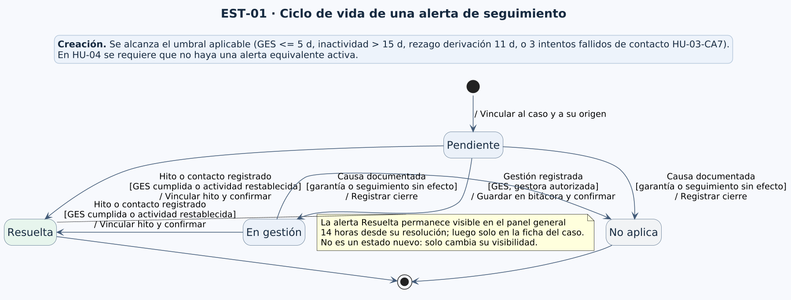
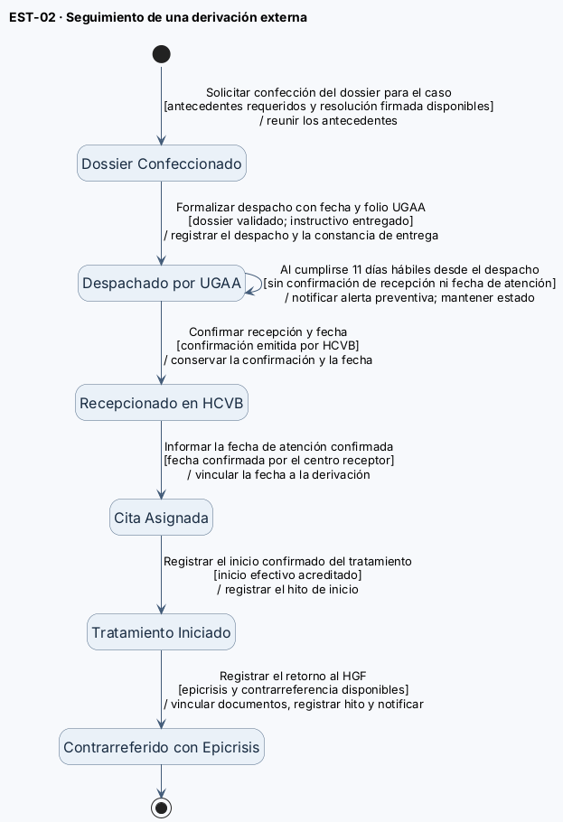
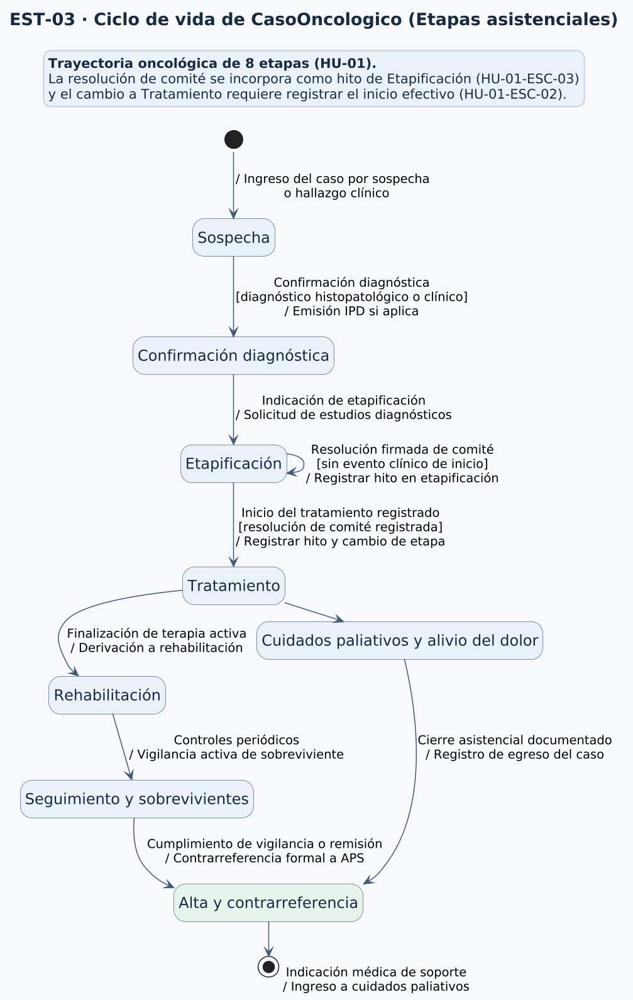
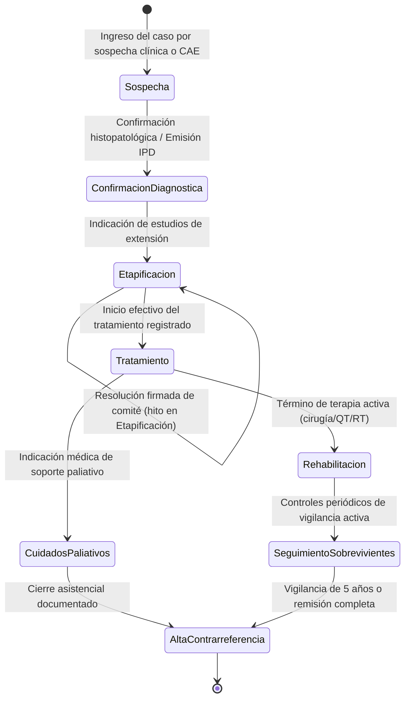
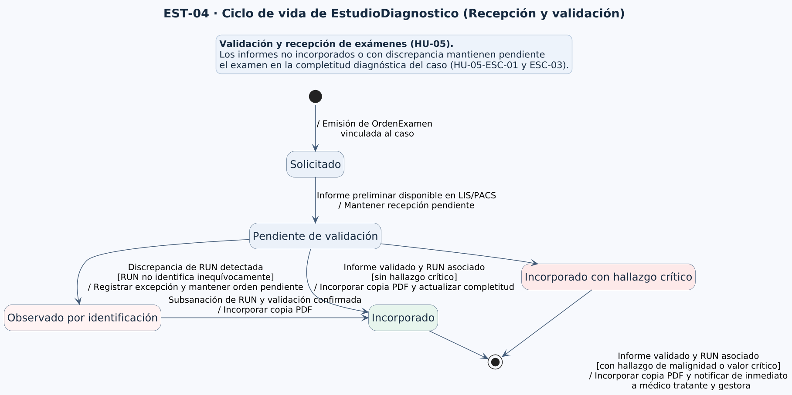
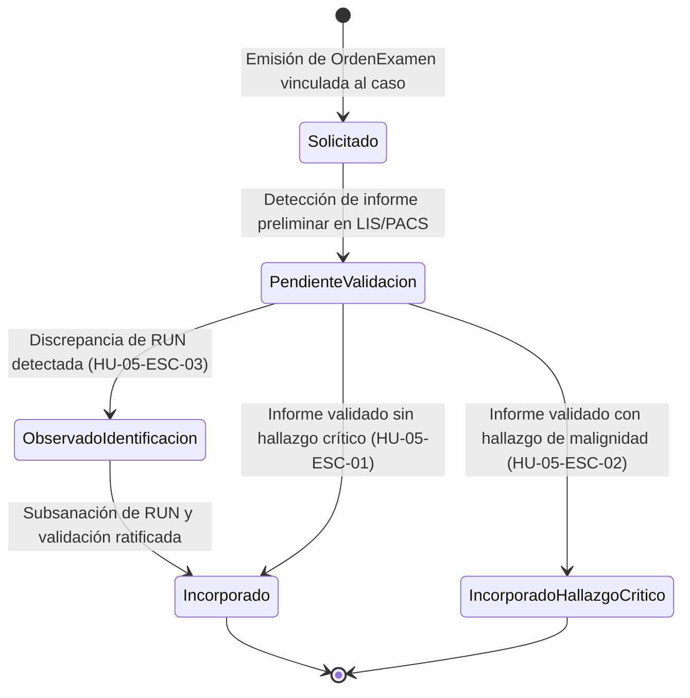

# Diagramas de estado

Este documento describe los estados y transiciones de las clases clave del dominio de OncoTrace con ciclo de vida relevante: `AlertaSeguimiento`, `DossierDigitalDerivacion`, `CasoOncologico` y `EstudioDiagnostico`. Los diagramas muestran las situaciones de cada objeto; las tablas precisan los eventos, las condiciones y las acciones que justifican los cambios.

**Referencias:** [Criterios de aceptación](./07-criterios-aceptacion.md) · [Modelo de dominio](./08-modelo-dominio.md) · [Casos de uso](./09-casos-de-uso.md) · [Diagramas de secuencia](./10-diagramas-secuencia.md) · [Historias de usuario](./04-historias-usuario.md).

---

## EST-01 — Ciclo de vida de AlertaSeguimiento

- **Clase del dominio:** [`AlertaSeguimiento`](./08-modelo-dominio.md).
- **Historias relacionadas:** [HU-04](./04-historias-usuario.md#hu-04), [HU-08](./04-historias-usuario.md#hu-08) y [HU-03](./04-historias-usuario.md#hu-03).
- **Casos de uso relacionados:** [CU-06 — Gestionar alertas de seguimiento](./09-casos-de-uso.md#casos-de-uso-y-su-origen) y [CU-11 — Registrar interacción en bitácora de acompañamiento](./09-casos-de-uso.md#casos-de-uso-y-su-origen).
- **Diagramas de secuencia relacionados:** [DSS-04](./10-diagramas-secuencia.md#dss-04--deteccion-y-gestion-de-alertas-preventivas-ges-e-inactividad) y [DSS-02](./10-diagramas-secuencia.md#dss-02--gestionar-derivacion-externa-y-retorno).

**Archivo fuente:** [estados-objetos.puml](../diagramas/estados-objetos.puml) (`@startuml EST-01-AlertaSeguimiento`).

### Descripción del ciclo de vida

La alerta comienza en **Pendiente** cuando se cumple el umbral correspondiente: cinco días hábiles o menos para el vencimiento de una garantía GES (HU-04); más de quince días corridos de inactividad (HU-04); once días hábiles desde el despacho de una derivación sin confirmación de recepción ni fecha de atención (HU-08); o tres intentos fallidos consecutivos de contacto en la bitácora («No contactable») para activar el protocolo de búsqueda activa y coordinación con APS (HU-03 / HU-03-CA7 / ESC-03). En HU-04, la evaluación repetida no genera alertas redundantes mientras la condición siga activa y pendiente de resolución.

### Tabla de transiciones

| Estado origen | Evento | Guarda | Acción | Estado destino |
| :--- | :--- | :--- | :--- | :--- |
| **Nodo inicial** | — | — | Vincular la alerta al caso y, según origen, a la garantía GES, al dossier o al registro de búsqueda activa | **Pendiente** |
| **Pendiente** | Registro de acción de gestión o contacto | [Gestora autorizada: acción sobre alerta GES, rezago de derivación o inicio de coordinación con APS para búsqueda activa] | Conservar la acción en bitácora; en GES no equivale al cumplimiento de la garantía | **En gestión** |
| **Pendiente** | Registro de resolución, cumplimiento o contacto | [Hito de cumplimiento de garantía GES, confirmación de derivación externa o restablecimiento de contacto / respuesta formal de APS] | Vincular el hito o antecedente que acredita la resolución y confirmar el cambio a la gestora | **Resuelta** |
| **En gestión** | Registro de resolución, cumplimiento o contacto | [Hito de cumplimiento de garantía GES, confirmación de derivación externa o restablecimiento de contacto / respuesta formal de APS] | Vincular el hito o antecedente que acredita la resolución y confirmar el cambio a la gestora | **Resuelta** |
| **Pendiente** | Registro de causa documentada | [Causa clínica/administrativa documentada deja sin efecto la garantía o el seguimiento asistencial] | Conservar el motivo, la fecha y la responsable del cierre | **No aplica** |
| **En gestión** | Registro de causa documentada | [Causa clínica/administrativa documentada deja sin efecto la garantía o el seguimiento asistencial] | Conservar el motivo, la fecha y la responsable del cierre | **No aplica** |
| **Resuelta** | — | — | — | **Fin** |
| **No aplica** | — | — | — | **Fin** |

> [!NOTE]
> **Gestión de alertas de búsqueda activa (HU-03-CA7):** La alerta generada tras tres intentos fallidos consecutivos de llamada/contacto pasa a **En gestión** cuando la gestora registra en la bitácora la coordinación con la red de Atención Primaria de Salud (APS), y transiciona a **Resuelta** cuando se restablece el contacto asistencial efectivo con el paciente o cuidador o se incorpora la respuesta formal del centro APS. Si una causa justificada documentada extingue el seguimiento (p. ej. traslado o egreso formal), se cierra con estado **No aplica**.

> [!NOTE]
> **Visibilidad de la alerta resuelta (HU-04 / ESC-06):** al quedar **Resuelta**, la alerta permanece visible en el panel general durante 14 horas desde su resolución y luego deja de listarse entre las alertas vigentes; sigue consultable en la ficha del caso. No se crea un estado nuevo: solo cambia su visibilidad.

---

## EST-02 — Ciclo de vida de DossierDigitalDerivacion

- **Clase del dominio:** [`DossierDigitalDerivacion`](./08-modelo-dominio.md).
- **Historia relacionada:** [HU-08](./04-historias-usuario.md#hu-08).
- **Diagrama de secuencia relacionado:** [DSS-02 — Derivación externa y retorno](./10-diagramas-secuencia.md#dss-02--gestionar-derivacion-externa-y-retorno).

**Archivo fuente:** [estados-objetos.puml](../diagramas/estados-objetos.puml) (`@startuml EST-02-DossierDigitalDerivacion`).

### Descripción del ciclo de vida

El dossier recorre los seis estados definidos para HU-08. Su ciclo comienza cuando TENS solicita confeccionarlo y están disponibles los antecedentes requeridos y la resolución firmada que indica la derivación. Para formalizar el despacho, el dossier debe estar completo y validado por UGAA, la entrega anticipada del instructivo del Anexo 6 debe quedar registrada y se deben informar la fecha y el folio. La recepción requiere confirmación emitida por HCVB. Si al cumplirse once días hábiles desde el despacho no hay confirmación de recepción ni fecha de atención, se genera una alerta y el dossier permanece **Despachado por UGAA**.

### Tabla de transiciones

| Estado origen | Evento | Guarda | Acción | Estado destino |
| :--- | :--- | :--- | :--- | :--- |
| **Nodo inicial** | — | — | Reunir los antecedentes y dejar el dossier disponible para validación de UGAA | **Dossier Confeccionado** |
| **Dossier Confeccionado** | Formalizar despacho con fecha y folio UGAA | [Dossier completo y validado por UGAA, constancia de entrega anticipada registrada y fecha y folio informados] | Registrar la fecha y el folio del despacho y asociar la constancia de entrega | **Despachado por UGAA** |
| **Despachado por UGAA** | Confirmar recepción y fecha | [Confirmación emitida por HCVB para esa derivación] | Conservar la confirmación y la fecha de recepción | **Recepcionado en HCVB** |
| **Despachado por UGAA** | Al cumplirse 11 días hábiles desde el despacho | [Sin confirmación de recepción ni fecha de atención] | Generar y notificar una alerta preventiva vinculada a la derivación | **Despachado por UGAA** |
| **Recepcionado en HCVB** | Informar la fecha de atención confirmada | [Fecha confirmada por el centro receptor] | Vincular la fecha de atención a la derivación | **Cita Asignada** |
| **Cita Asignada** | Registrar el inicio confirmado del tratamiento | [Antecedente que confirma el inicio disponible] | Registrar el hito de inicio en el caso | **Tratamiento Iniciado** |
| **Tratamiento Iniciado** | Registrar el retorno al HGF | [Atención externa finalizada y epicrisis y contrarreferencia disponibles] | Vincular ambos documentos, registrar el hito de retorno y notificar a la gestora | **Contrarreferido con Epicrisis** |
| **Contrarreferido con Epicrisis** | — | — | — | **Fin** |

---

## EST-03 — Ciclo de vida de CasoOncologico (Etapas asistenciales)

- **Clase del dominio:** [`CasoOncologico`](./08-modelo-dominio.md).
- **Historia relacionada:** [HU-01](./04-historias-usuario.md#hu-01).
- **Caso de uso relacionado:** [CU-05 — Dar seguimiento al caso oncológico](./09-casos-de-uso.md#casos-de-uso-y-su-origen).
- **Diagrama de secuencia relacionado:** [DSS-03](./10-diagramas-secuencia.md#dss-03--dar-seguimiento-al-caso-oncologico).

**Archivo fuente:** [estados-objetos.puml](../diagramas/estados-objetos.puml) (`@startuml EST-03-CasoOncologico`).

### Descripción del ciclo de vida

El objeto `CasoOncologico` transiciona a lo largo de las ocho etapas normadas de la trayectoria asistencial. De acuerdo con los criterios de aceptación de HU-01:
1. La resolución de comité es un **hito asistencial dentro de la etapa de Etapificación**, por lo que su registro no cambia la etapa del caso ni crea una etapa denominada "Comité" ([HU-01-ESC-03](./07-criterios-aceptacion.md#hu-01-esc-03-resolucion-de-comite-sin-inicio-del-tratamiento)).
2. El cambio a la etapa **Tratamiento** exige que un profesional autorizado registre el evento de inicio efectivo de la terapia prescrita ([HU-01-ESC-02](./07-criterios-aceptacion.md#hu-01-esc-02-cambio-de-etapa-por-inicio-del-tratamiento)).
3. El cierre formal se alcanza en **Alta y contrarreferencia**, tras completarse la vigilancia de sobrevivientes (5 años), remisión clínica completa, traslado de red o fallecimiento.

### Tabla de transiciones

| Estado origen | Evento | Guarda | Acción | Estado destino |
| :--- | :--- | :--- | :--- | :--- |
| **Nodo inicial** | — | — | Ingreso por derivación CAE, APS, Urgencias o hallazgo AP | **Sospecha** |
| **Sospecha** | Confirmación diagnóstica | [Diagnóstico histopatológico o clínico validado] | Notificar al paciente y emitir IPD si es patología GES | **Confirmación diagnóstica** |
| **Confirmación diagnóstica** | Indicación de etapificación | [Exámenes de extensión requeridos] | Emitir órdenes diagnósticas e iniciar rescate de exámenes | **Etapificación** |
| **Etapificación** | Registro de resolución de comité | [Sin confirmación clínica de inicio de terapia] | Registrar hito en línea de tiempo; mantener caso en Etapificación | **Etapificación** |
| **Etapificación** | Registro de inicio de tratamiento | [Resolución previa de comité y acto médico de inicio] | Registrar hito con responsable y actualizar tablero Kanban | **Tratamiento** |
| **Tratamiento** | Término de terapia activa | [Cirugía, ciclos QT o RT completados] | Derivar a equipo multidisciplinario (kine/psicosocial) | **Rehabilitación** |
| **Tratamiento** | Indicación de cuidados paliativos | [Criterio médico de soporte paliativo/alivio dolor] | Registrar ingreso a Unidad de Cuidados Paliativos | **Cuidados paliativos y alivio del dolor** |
| **Rehabilitación** | Egreso de rehabilitación | [Plan terapéutico funcional completado] | Iniciar controles periódicos de vigilancia activa | **Seguimiento y sobrevivientes** |
| **Cuidados paliativos** | Cierre asistencial | [Remisión, traslado a otra red o fallecimiento] | Registrar fecha, motivo y responsable del cierre | **Alta y contrarreferencia** |
| **Seguimiento y sobrevivientes**| Fin de período de vigilancia | [Remisión cumplida a 5 años o contrarreferencia a APS] | Formalizar contrarreferencia a APS y registrar alta | **Alta y contrarreferencia** |
| **Alta y contrarreferencia** | — | — | — | **Fin** |

---

## EST-04 — Ciclo de vida de EstudioDiagnostico (Recepción y validación)

- **Clase del dominio:** [`EstudioDiagnostico`](./08-modelo-dominio.md).
- **Historia relacionada:** [HU-05](./04-historias-usuario.md#hu-05).
- **Casos de uso relacionados:** [CU-01 y CU-02](./09-casos-de-uso.md#casos-de-uso-y-su-origen).
- **Diagrama de secuencia relacionado:** [DSS-01](./10-diagramas-secuencia.md#dss-01--incorporar-y-consultar-informes-diagnosticos).

**Archivo fuente:** [estados-objetos.puml](../diagramas/estados-objetos.puml) (`@startuml EST-04-EstudioDiagnostico`).

### Descripción del ciclo de vida

El objeto `EstudioDiagnostico` modela la sincronización con LIS y PACS y los atributos `estadoValidacion` y `estadoRecepcion`. Un examen solicitado permanece pendiente en la completitud del caso hasta que su informe esté **validado** en el origen y su RUN se asocie **inequívocamente** al paciente ([HU-05-ESC-01](./07-criterios-aceptacion.md#hu-05-esc-01-incorporacion-y-consulta-de-un-informe-validado)). Si existe discrepancia de identificación, se deriva a una bandeja de excepciones para auditoría sin asociarlo indebidamente ([HU-05-ESC-03](./07-criterios-aceptacion.md#hu-05-esc-03-identificacion-discrepante-del-paciente)).

### Tabla de transiciones

| Estado origen | Evento | Guarda | Acción | Estado destino |
| :--- | :--- | :--- | :--- | :--- |
| **Nodo inicial** | — | — | Emisión de `OrdenExamen` vinculada al caso | **Solicitado** |
| **Solicitado** | Detección de informe en LIS/PACS | [Informe no validado por especialista de origen] | Mantener recepción pendiente en el caso (completitud sin variar) | **Pendiente de validación** |
| **Pendiente de validación** | Cotejo de identificación | [RUN informado no permite asociar inequívocamente al paciente] | Registrar excepción de auditoría; examen sigue pendiente | **Observado por identificación** |
| **Observado por identificación**| Subsanación de discrepancia | [Identificación validada y ratificada por auditoría] | Incorporar informe consolidado y copia PDF | **Incorporado** |
| **Pendiente de validación** | Recepción de informe validado | [RUN validado inequívocamente y sin hallazgo crítico] | Incorporar copia PDF y actualizar completitud diagnóstica | **Incorporado** |
| **Pendiente de validación** | Recepción de informe validado | [RUN validado y hallazgo de malignidad o valor crítico] | Incorporar PDF y disparar notificación inmediata a médico y gestora | **Incorporado con hallazgo crítico** |
| **Incorporado** | — | — | — | **Fin** |
| **Incorporado con hallazgo crítico** | — | — | — | **Fin** |

---

## Fuente editable

El archivo PlantUML editable que contiene los cuatro diagramas de estado se encuentra en el repositorio:

- [estados-objetos.puml](../diagramas/estados-objetos.puml)
