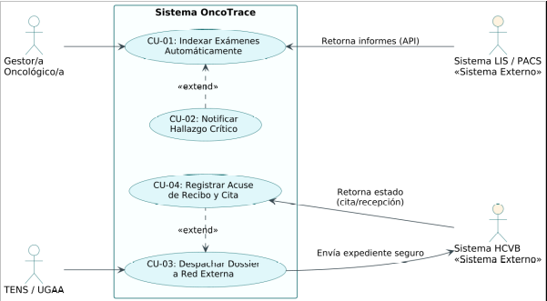

# OncoTrace

### Gestión, navegación y trazabilidad oncológica

**CIN324 · Ingeniería de Requisitos · Entrega 1**  
**Hospital Dr. Gustavo Fricke (HGF) · Unidad de Gestión de Casos Oncológicos (UGCO)**

---

OncoTrace es una propuesta de plataforma para apoyar la gestión de casos oncológicos en la UGCO del HGF. El proyecto reúne el seguimiento de pacientes, la evaluación multidimensional, la coordinación de comités, el control de plazos GES y la trazabilidad de derivaciones.

La UGCO depende administrativamente de la *Subdirección de Gestión del Cuidado* y técnicamente de la *Subdirección Médica*.

## Trayectoria asistencial

El alcance contempla el recorrido desde la sospecha hasta el alta, la contrarreferencia o el seguimiento de sobrevivientes:

**Sospecha → Confirmación diagnóstica → Etapificación → Comité oncológico → Tratamiento → Rehabilitación y cuidados paliativos → Seguimiento → Alta y contrarreferencia**

## Problemas y respuesta propuesta

| Problema actual | Propuesta de OncoTrace | Trazabilidad |
| :--- | :--- | :--- |
| **AS-01 · Resultados diagnósticos dispersos** | Tablero con línea de tiempo y consolidación de informes LIS/PACS por RUN, con alertas ante hallazgos críticos. | TB-01, TB-05 · RF-01, RF-05 |
| **AS-02 · Comités gestionados en papel** | Ficha de presentación generada desde los antecedentes clínicos, acta digital con firma electrónica y reporte REM 7. | TB-06, TB-07 · RF-06, RF-07 |
| **AS-03 · Derivaciones sin seguimiento** | Dossier digital, seguimiento de la derivación externa y apoyo para entregar el instructivo de reembolso de pasajes (Anexo 6). | TB-08 · RF-08 |
| **AS-04 · Plazos GES en planillas** | Alertas preventivas a cinco días hábiles o menos del vencimiento y aviso de casos sin movimiento por más de 15 días. | TB-01, TB-04 · RF-01, RF-04 |
| **AS-05 · Evaluación y contactos fragmentados** | Evaluación multidimensional, bitácora de acompañamiento y control de los seis puntos de contacto. | TB-02, TB-03, TB-04 · RF-02, RF-03, RF-04 |
| **AS-06 · Consultas espontáneas en el mesón** | Tótem de autoatención y asistente de orientación y triage, vinculados a requisitos de seguridad y confidencialidad. | TB-09, TB-10 · RF-09, RF-10 · RNF-03 |

**Dominios de evaluación:** clínico-funcional (ECOG 0–4); psicosocial y socioeconómico; familiar y del cuidador; espiritual y comprensión diagnóstica.

## Acceso y orientación

- **Tótem:** La consulta usa el método de verificación de identidad autorizado por el hospital. Leer la cédula o ingresar el RUN no basta por sí solo; el cuidador necesita autorización vigente.

- **Asistente virtual:** Orienta y ordena solicitudes, pero no realiza diagnósticos. Ante síntomas que podrían requerir atención de emergencia, dirige a la Unidad de Emergencia Adultos. Si no puede clasificar la solicitud, ofrece contacto con personal de la UGCO.

## Actores principales

| Grupo | Participantes |
| :--- | :--- |
| **UGCO** | Gestor/a de casos, enfermera supervisora, TENS (Técnico en Enfermería) y personal administrativo. |
| **Equipo clínico y de apoyo** | Médico tratante, Comité Oncológico Regional, equipo multidisciplinario y Unidad de Servicio Social. |
| **Red asistencial** | APS (Atención Primaria de Salud), red SSVQ, UGDA (Unidad de Gestión de la Demanda Asistencial), UGAA (Unidad de Gestión de Atención Abierta), Unidad GES, unidades de apoyo diagnóstico, Hospital Carlos Van Buren y prestadores externos. |
| **Personas atendidas** | Personas con cáncer y sus cuidadores principales. |

En el proceso actual, el TENS confecciona dossiers físicos. El rediseño propone digitalizar el dossier y seguir el estado de la derivación.

## Diagramas y modelos

| Recurso | Archivo |
| :--- | :--- |
| Proceso actual en BPMN 2.0 | [AS-IS](./diagramas/as-is.bpmn) |
| Proceso propuesto en BPMN 2.0 | [TO-BE](./diagramas/to-be.bpmn) |
| Modelo de dominio UML | [Clases y relaciones](./diagramas/modelo-de-dominio-uml.md) |
| Casos de uso y diagramas SSD | [Modelo de integración](./diagramas/diagrama-casos-de-uso.md) |
| Imagen del diagrama de integración | [casos-de-uso-integracion.png](./diagramas/casos-de-uso-integracion.png) |
| Secuencia del sistema | [HU-05](./diagramas/ssd-hu05.png) · [HU-08](./diagramas/ssd-hu08.png) |

### Diagrama de casos de uso e integración

## Documentación de la Entrega 1

| Documento | Contenido |
| :--- | :--- |
| [Documento integrador](./IngReq-Entrega%201.md) | Síntesis de la Entrega 1 y enlaces a sus componentes. |
| [01 · Proceso AS-IS](./01-proceso-as-is.md) | Proceso actual y problemas identificados. |
| [02 · Rediseño TO-BE](./02-rediseno-to-be.md) | Proceso propuesto y actividades de mejora. |
| [03 · Requisitos](./03-requisitos.md) | Requisitos funcionales, no funcionales y de proyecto. |
| [04 · Historias de usuario](./04-historias-usuario.md) | Historias de usuario y criterios de aceptación. |
| [05 · Elicitación](./05-elicitacion.md) | Entrevista, normativa y manuales UGCO (EL-01 a EL-03). |
| [06 · Atributos de calidad](./06-atributos-calidad.md) | Escenarios de calidad AC-01 a AC-03. |
| [07 · Matriz de trazabilidad](./07-matriz-trazabilidad.md) | Relación entre problemas, soluciones, requisitos e historias. |

Los manuales y registros de entrevista están en [`evidencia/`](./evidencia/). La guía para conducir entrevistas está en [`entrevistador-elicitacion/skill.md`](./entrevistador-elicitacion/skill.md).

## Equipo de trabajo

| Integrante | Entregables a cargo |
| :--- | :--- |
| **Bruno Fernandez** | [`01-proceso-as-is.md`](./01-proceso-as-is.md) y [`05-elicitacion.md`](./05-elicitacion.md) |
| **Benjamin Carcamo** | [`02-rediseno-to-be.md`](./02-rediseno-to-be.md) |
| **Máximo Torrijo** | [`03-requisitos.md`](./03-requisitos.md) y [`06-atributos-calidad.md`](./06-atributos-calidad.md) |
| **Ignacio Jorquera** | [`04-historias-usuario.md`](./04-historias-usuario.md) |
| **Equipo completo** | [`07-matriz-trazabilidad.md`](./07-matriz-trazabilidad.md), integración transversal y trazabilidad |

## Integración y marco normativo

| Ámbito | Referencias del proyecto |
| :--- | :--- |
| **Interoperabilidad propuesta** | HL7 FHIR / API REST con la Ficha Clínica Electrónica, LIS, RIS/PACS y la Plataforma Oncológica MINSAL. |
| **Seguridad y privacidad** | Control de acceso por roles (RBAC), auditoría y resguardo de información clínica. |
| **Marco normativo** | Ley N° 20.584, Ley Nacional del Cáncer N° 21.258 y Decreto Supremo N° 29 para garantías GES. |
