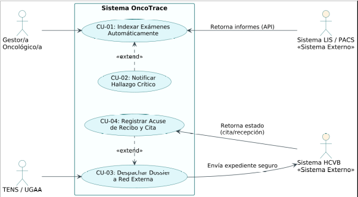
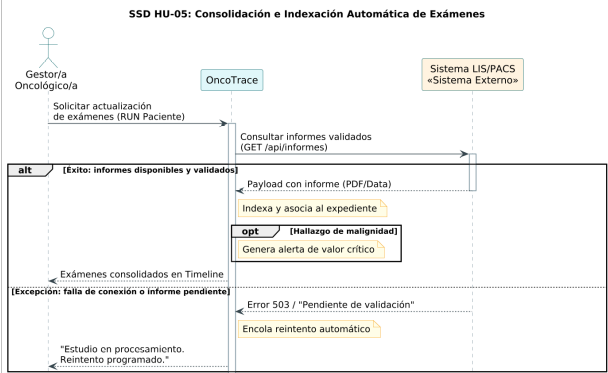
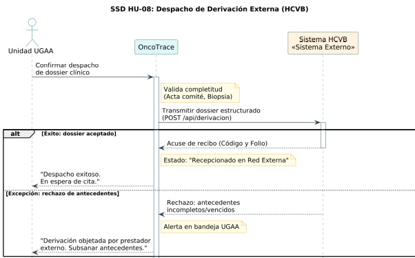

# Integración con Sistemas Externos (HU-05 y HU-08)

> **Proyecto:** OncoTrace – Hospital Dr. Gustavo Fricke (HGF)  
> **Unidad:** Unidad de Gestión de Casos Oncológicos (UGCO)  
> **Artefactos:** Diagrama de Casos de Uso UML y Diagramas de Secuencia del Sistema (SSD)

---

## 1. Selección de Historias de Usuario

* **HU-05: Consolidación e Indexación Automática de Exámenes**
  * **Sistema Externo:** Sistema LIS (Laboratorio / Biopsias) y PACS (Imágenes) institucional vía HL7 FHIR.
  * **Descripción:** Como Gestor/a Oncológico/a, quiero que los resultados de biopsias e imágenes se sincronicen e indexen automáticamente en la ficha del paciente, para eliminar la búsqueda manual en visores aislados.

* **HU-08: Gestión de Dossier Digital, Derivaciones Externas y Reembolso de Pasajes**
  * **Sistema Externo:** Sistema de Gestión de Red Asistencial (Hospital Carlos Van Buren - HCVB / MINSAL) y Unidad de Servicio Social HGF.
  * **Descripción:** Como TENS / Administrativo UGAA, quiero despachar el dossier clínico digital consolidado, emitir el instructivo de reembolso de pasajes (Anexo 6) y recibir confirmación de recepción y agendamiento desde el centro externo, para erradicar los puntos ciegos asistenciales y proteger financieramente al paciente.

---

## 2. Diagrama de Casos de Uso (UML)

El modelo sitúa a los actores humanos a la izquierda de la frontera del sistema y a las plataformas externas a la derecha como actores secundarios.

### Especificación de Casos de Uso:
* **CU-01:** Indexar Exámenes Automáticamente (Interacción con LIS/PACS).
* **CU-02:** Notificar Hallazgo Crítico (`<<extend>>` de CU-01 condicionado a resultado positivo de malignidad).
* **CU-03:** Despachar Dossier a Red Externa y Adjuntar Instructivo de Pasajes (Interacción con HCVB / Anexo 6 Servicio Social).
* **CU-04:** Registrar Acuse de Recibo y Cita (`<<extend>>` de CU-03).

---

## 3. Diagramas de Secuencia del Sistema (SSD)

Ambos diagramas respetan el principio de **caja negra**, ocultando la implementación interna de OncoTrace y utilizando fragmentos combinados `alt` para el flujo principal y las variantes de excepción.

### 3.1. SSD HU-05: Consolidación de Exámenes (LIS/PACS)
* **Flujo Principal:** Recepción exitosa de informe validado y notificación de valor crítico.
* **Variante `alt`:** Falla de conexión con la API o informe en estado pendiente de validación.

---

### 3.2. SSD HU-08: Despacho de Derivación Externa (HCVB)
* **Flujo Principal:** Despacho de dossier completo y retorno de acuse de recibo con código de recepción.
* **Variante `alt`:** Rechazo o reparo de la derivación por antecedentes incompletos en la macrored.

---

## 4. Validación de Criterios y Errores Comunes

| Criterio Evaluado | Justificación del Modelado |
| :--- | :--- |
| **Modelado de Caja Negra** | OncoTrace se representa como una única línea de vida central (`System`). La lógica interna (validar, indexar, encolar) se consigna mediante notas operativas y no como mensajes entre objetos internos. |
| **Uso Riguroso de `alt` y `opt`** | Se estructuran bloques condicionales formales para separar el flujo exitoso de las excepciones de conectividad o rechazo administrativo. |
| **Sistemas Externos como Actores** | Tanto LIS/PACS como el Sistema HCVB se posicionan como actores secundarios fuera del límite del sistema, evidenciando la frontera B2B / API. |
| **Consistencia de Dominio** | La nomenclatura utilizada (dossier, biopsia, RUN, folio de derivación, valor crítico) coincide de forma unívoca con el proceso asistencial y la documentación del proyecto. |
