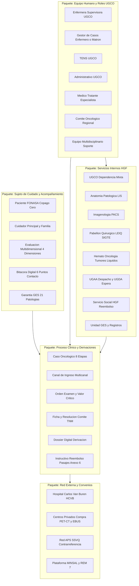
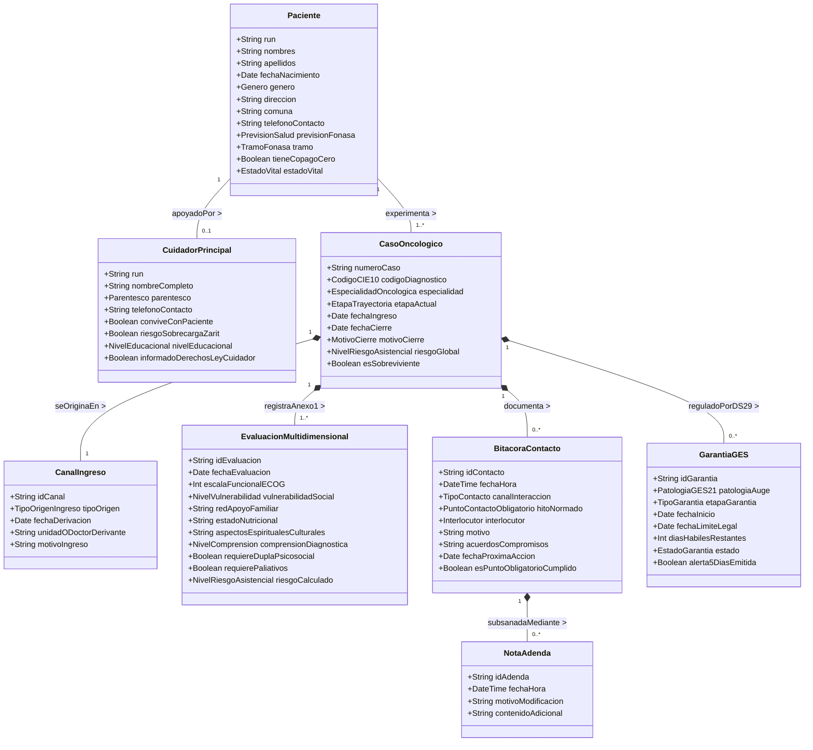
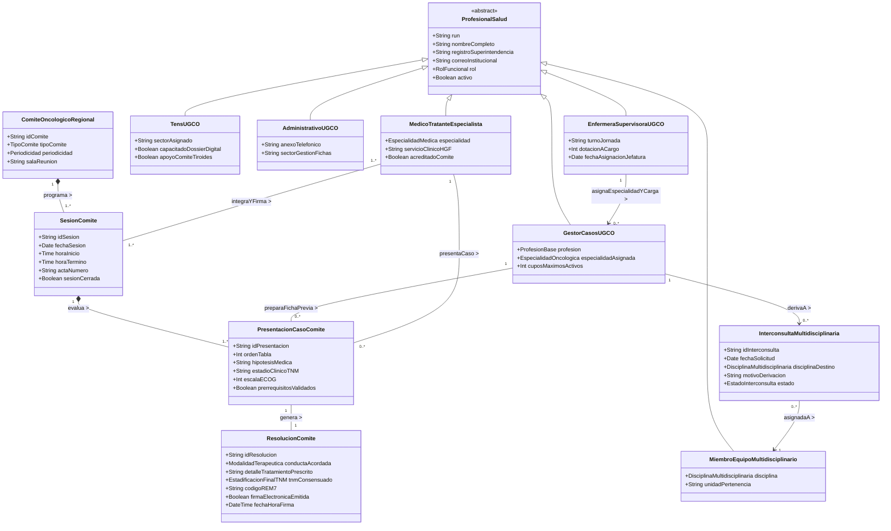

# Modelo de Dominio UML – Sistema de Gestión Oncológica OncoTrace
**Hospital Dr. Gustavo Fricke (HGF) – Red Asistencial SSVQ / Macrored**  
**Proyecto:** OncoTrace – Plataforma de Trazabilidad, Gestión, Evaluación y Acompañamiento Oncológico  
**Fuentes Normativas:** Manual de Organización y Funcionamiento UGCO v2.0, Manual de Procedimientos UGCO v2.0 Final (Octubre 2026), Transcripción de Entrevista Clínica, Ley N° 21.258, Ley N° 20.584, DS N° 29 (GES).  
**Versión:** 2.0 (Alineada con Evidencias y Manuales Institucionales)

---

## 1. Introducción y Marco Conceptual del Dominio

El presente documento formaliza el **Modelo de Dominio (Domain Model)** para la gestión clínica, seguimiento y navegación de pacientes en la **Unidad de Gestión de Casos Oncológicos (UGCO)** del **Hospital Dr. Gustavo Fricke (HGF)** y su articulación con la red macro-regional (Servicio de Salud Viña del Mar – Quillota y Hospital Carlos Van Buren).

Basado directamente en los manuales de procedimientos oficiales y la elicitación en terreno, el modelo conceptualiza:
1. **Sujeto de Cuidado:** El binomio indivisible Persona con Cáncer y Cuidador Principal (Leyes N° 21.258, N° 21.168 y N° 21.380), su caracterización socioeconómica y el seguimiento de garantías GES (21 patologías oncológicas y asociadas).
2. **Equipo Asistencial UGCO y Estructura Organizacional:** Dotación oficial de 9 profesionales con dependencia mixta (Subdirección de Gestión del Cuidado y Subdirección Médica), liderados por la Enfermera Supervisora, Gestores Oncológicos por especialidad, Técnicos en Enfermería (TENS) y Administrativos.
3. **Equipo Médico y Órganos Resolutivos:** Médicos tratantes especialistas y el Comité Oncológico Regional (confección de Ficha Resumen, firma electrónica de Acta Digital y reporte estadístico ministerial REM 7).
4. **Equipo Multidisciplinario de Soporte:** Derivaciones a dupla psicosocial (psicólogo y trabajador social), nutrición oncológica, kinesiología, fonoaudiología, terapia ocupacional, oncogeriatría y cuidados paliativos.
5. **Servicios Hospitalarios Internos del HGF:** Anatomía Patológica (LIS, con pesquisa de valores críticos y biopsias), Imagenología (PACS), Pabellón Quirúrgico (LEIQ / SIGTE), Hemato-Oncología (tumores líquidos), Unidad GES y Unidad de Servicio Social.
6. **Red Externa Interhospitalaria y Convenios:** Derivación formal a la macrored (Hospital Carlos Van Buren para radioterapia y quimioterapia de tumores sólidos), alianzas colaborativas (Hospital del Tórax y San Borja para EBUS), compra de servicios privados (PET-CT en OncoCenter / Red de Clínicas), APS y el circuito de Reembolso de Pasajes (Anexo 6).

---

## 2. Mapa Arquitectónico de Paquetes de Dominio

---

## 3. Diagramas de Clases de Dominio (UML)

### 3.1. Subdominio 1: Sujeto de Cuidado, Cuidador y Acompañamiento
Modela al paciente FONASA (bajo política de copago cero), su cuidador principal evaluado por sobrecarga de Zarit, la pauta de valoración inicial por dominios (Anexo 1 del Manual) y los 6 puntos de contacto obligatorio normados en el *Patient Journey Map*.

---

### 3.2. Subdominio 2: Equipo Médico, Roles UGCO y Comités Oncológicos
Modela la dotación oficial de 9 profesionales de la UGCO, la supervisión estratégica, la presentación en comités por tipo de tumor y la interconsulta al equipo multidisciplinario.

---

### 3.3. Subdominio 3: Servicios Internos del Hospital Dr. Gustavo Fricke (HGF)
Modela los servicios diagnósticos, la gestión de toma de muestras por parte del gestor (no del paciente), el LIS de anatomía patológica con alerta de valores críticos, el PACS y la lista quirúrgica LEIQ/SIGTE.

```mermaid
classDiagram
    direction TB

    class ServicioHospitalarioHGF {
        <<abstract>>
        +String codigoServicio
        +String nombreServicio
        +UbicacionHGF ubicacionEdificio
        +String jefaturaACargo
    }

    class UGCO {
        +DependenciaJerarquica dependenciaAdministrativa
        +DependenciaJerarquica dependenciaTecnica
        +Int dotacionEfectiva
    }

    class UnidadAnatomiaPatologica {
        +String conexionLIS
        +Int plazoDiasBiopsiaRapida
        +Int plazoDiasBiopsiaDiferida
    }

    class ServicioImagenologia {
        +String conexionPACS
        +ModalidadImagen modalidades
    }

    class PabellonQuirurgico {
        +String conexionSIGTE
        +Int cuposQuirurgicosOncologicos
    }

    class ServicioHematoOncologia {
        +Int camasHospitalizacion
        +Int sillonesInfusionQuimioterapia
    }

    class UnidadServicioSocial {
        +String encargadoConvenioTransporte
        +String lugarAtencion1erPiso
    }

    class UnidadGESRegistros {
        +String sistemaSIGGES
        +Boolean monitoreoActivo
    }

    class OrdenExamen {
        +String idOrden
        +Date fechaEmision
        +TipoEstudio tipoEstudio
        +FormatoSolicitud formato
        +Boolean tramitadoPorGestor
        +EstadoTramiteExamen estado
    }

    class EstudioDiagnostico {
        <<abstract>>
        +String idEstudio
        +TipoEstudio tipo
        +Date fechaEjecucion
        +Date fechaInforme
        +Boolean tieneHallazgoMalignidad
        +String rutaInformePDF
    }

    class InformeBiopsia {
        +String numeroBiopsiaLIS
        +TipoMuestra tejidoMuestra
        +String descripcionMacroscopica
        +String diagnosticoHistopatologico
        +String gradoDiferenciacion
        +Boolean esValorCriticoAlertado
        +DateTime fechaHoraAlertaMedico
    }

    class InformeRadiologico {
        +String idEstudioPACS
        +ModalidadImagen modalidad
        +String regionAnatomica
        +String hallazgosRadiologicos
        +String conclusionTNM_Sugerida
    }

    class SolicitudQuirurgicaLEIQ {
        +String folioSIGTE
        +Date fechaIngresoListaEspera
        +ClasificacionSIGTE categoriaOncologica
        +PrioridadQuirurgica prioridad
        +EstadoLEIQ estadoIntervencion
    }

    ServicioHospitalarioHGF <|-- UGCO
    ServicioHospitalarioHGF <|-- UnidadAnatomiaPatologica
    ServicioHospitalarioHGF <|-- ServicioImagenologia
    ServicioHospitalarioHGF <|-- PabellonQuirurgico
    ServicioHospitalarioHGF <|-- ServicioHematoOncologia
    ServicioHospitalarioHGF <|-- UnidadServicioSocial
    ServicioHospitalarioHGF <|-- UnidadGESRegistros

    EstudioDiagnostico <|-- InformeBiopsia
    EstudioDiagnostico <|-- InformeRadiologico

    OrdenExamen "1" --> "0..1" EstudioDiagnostico : generaResultado >
    UnidadAnatomiaPatologica "1" *-- "0..*" InformeBiopsia : procesa >
    ServicioImagenologia "1" *-- "0..*" InformeRadiologico : procesa >
    PabellonQuirurgico "1" *-- "0..*" SolicitudQuirurgicaLEIQ : gestiona >
```

---

### 3.4. Subdominio 4: Servicios Externos, Red Asistencial y Compra de Servicios
Modela la división territorial de la atención oncológica en Chile (zona norte: tumores sólidos y radioterapia al Hospital Carlos Van Buren; tumores hematológicos en el Fricke), alianzas para procedimientos específicos (EBUS en Tórax/San Borja), compras de servicios privados (PET-CT) y el Reembolso de Pasajes (Anexo 6).

```mermaid
classDiagram
    direction TB

    class EstablecimientoExterno {
        <<abstract>>
        +String codigoDEIS
        +String nombreEstablecimiento
        +TipoEstablecimientoRed red
        +String comuna
    }

    class HospitalCarlosVanBuren {
        +Boolean servicioRadioterapiaActivo
        +Boolean unidadQuimioterapiaSolidaActiva
        +String canalInteroperabilidadRed
    }

    class CentroSaludPrivadoConvenio {
        +String razonSocial
        +ConvenioPublico convenioSuministro
        +PrestacionTercerizada prestacionOfrecida
    }

    class HospitalAlianzaColaborativa {
        +String procedimientoDisponibleEBUS
        +String convenioInterhospitalario
    }

    class CentroAPS_SSVQ {
        +String redComunal
        +TipoCentroAPS tipoCentro
    }

    class DossierDigitalDerivacion {
        +String idDossier
        +String folioUGAA
        +DateTime fechaConfeccionTENS
        +DateTime fechaDespachoUGAA
        +EstadoDerivacionRed estadoWorkflow
        +Date fechaRecepcionHCVB
        +Date fechaCitaPrimeraAtencion
        +Boolean alerta10DiasSinRespuesta
    }

    class OrdenCompraServicioExterna {
        +String numeroOrdenCompra
        +PrestacionTercerizada prestacionSolicitada
        +Date fechaEmisionOrden
        +Date fechaCitaAgendada
        +EstadoCompraServicio estadoTramite
    }

    class InstructivoReembolsoPasajes {
        +String folioAnexo6
        +DateTime fechaEntregaAlInicio
        +MedioTransportePermitido medioAutorizado
        +Boolean excluyeAplicacionesYParticular
        +Boolean pacienteInstruidoRequisitos
        +EstadoReembolso estadoTramite
    }

    class ContraReferenciaEpicrisis {
        +String folioEpicrisis
        +Date fechaRetornoHGF
        +TratamientoCompletado tratamientoEfectuado
        +String dosisRadioterapiaOEsquemaQT
        +EstadoRespuestaTumoral respuestaClinica
        +String planSeguimientoSugerido
    }

    EstablecimientoExterno <|-- HospitalCarlosVanBuren
    EstablecimientoExterno <|-- CentroSaludPrivadoConvenio
    EstablecimientoExterno <|-- HospitalAlianzaColaborativa
    EstablecimientoExterno <|-- CentroAPS_SSVQ

    DossierDigitalDerivacion "1" --> "1" HospitalCarlosVanBuren : despachadoHacia >
    DossierDigitalDerivacion "1" *-- "0..1" InstructivoReembolsoPasajes : entregaAnexo6AlInicio >
    DossierDigitalDerivacion "1" -- "0..1" ContraReferenciaEpicrisis : retornaCon >
    OrdenCompraServicioExterna "1" --> "1" CentroSaludPrivadoConvenio : tercerizadaA >
    OrdenCompraServicioExterna "1" --> "0..1" HospitalAlianzaColaborativa : colaboracionParaEBUS >
```

---

### 3.5. Diagrama de Clases de Dominio Integrado (Master Class Diagram)
Consolidación integral de extremo a extremo que relaciona pacientes, equipo asistencial, servicios hospitalarios y centros de la macrored alrededor del ciclo de vida del **`CasoOncologico`**:

```mermaid
classDiagram
    direction TB

    class Paciente {
        +String run
        +String nombreCompleto
        +PrevisionSalud previsionFonasa
        +TramoFonasa tramo
    }

    class CuidadorPrincipal {
        +String run
        +String nombreCompleto
        +Parentesco parentesco
        +Boolean riesgoSobrecargaZarit
    }

    class CasoOncologico {
        +String numeroCaso
        +CodigoCIE10 codigoDiagnostico
        +EspecialidadOncologica especialidad
        +EtapaTrayectoria etapaActual
        +Date fechaIngreso
        +NivelRiesgoAsistencial riesgo
        +Boolean esSobreviviente
    }

    class CanalIngreso {
        +TipoOrigenIngreso tipoOrigen
        +Date fechaDerivacion
    }

    class EnfermeraSupervisoraUGCO {
        +String run
        +String nombreCompleto
    }

    class GestorCasosUGCO {
        +String run
        +String nombreCompleto
        +EspecialidadOncologica especialidad
    }

    class TensUGCO {
        +String run
        +String nombreCompleto
    }

    class MedicoTratante {
        +String run
        +String nombreCompleto
        +EspecialidadMedica especialidad
    }

    class EvaluacionMultidimensional {
        +Date fecha
        +Int ecog
        +NivelVulnerabilidad vulnerabilidad
        +Boolean requierePaliativos
    }

    class BitacoraContacto {
        +DateTime fechaHora
        +PuntoContactoObligatorio hitoNormado
        +TipoContacto canal
        +String acuerdos
    }

    class GarantiaGES {
        +PatologiaGES21 patologia
        +TipoGarantia tipo
        +Date fechaLimiteLegal
        +Int diasRestantes
    }

    class OrdenExamen {
        +String idOrden
        +TipoEstudio tipo
        +Boolean tramitadoPorGestor
    }

    class EstudioDiagnostico {
        +String idEstudio
        +TipoEstudio tipo
        +Date fechaInforme
        +Boolean hallazgoMalignidad
        +String rutaInformePDF
    }

    class InformeBiopsia {
        +String numeroBiopsiaLIS
        +String diagnosticoHistopatologico
        +Boolean valorCriticoAlertado
    }

    class InformeRadiologico {
        +String idEstudioPACS
        +ModalidadImagen modalidad
        +String hallazgos
    }

    class ComiteOncologicoRegional {
        +TipoComite tipo
    }

    class ResolucionComite {
        +ModalidadTerapeutica conductaAcordada
        +String tnmConsensuado
        +String codigoREM7
        +Boolean firmadoDigitalmente
    }

    class SolicitudLEIQ {
        +String folioSIGTE
        +Date fechaListaEspera
        +ClasificacionSIGTE categoriaOnco
    }

    class DossierDigitalDerivacion {
        +String folioUGAA
        +DateTime fechaDespacho
        +EstadoDerivacionRed estado
        +Date fechaRecepcionHCVB
    }

    class InstructivoReembolsoPasajes {
        +String folioAnexo6
        +DateTime fechaEntregaAlInicio
        +Boolean soloTransportePublico
    }

    class HospitalCarlosVanBuren {
        +String servicioRadioterapia
        +String unidadQuimioterapiaSolida
    }

    class CentroPrivadoConvenio {
        +String nombreCentro
        +PrestacionTercerizada tipoEstudio
    }

    class ContraReferenciaEpicrisis {
        +Date fechaRetorno
        +String resumenTratamiento
    }

    EstudioDiagnostico <|-- InformeBiopsia
    EstudioDiagnostico <|-- InformeRadiologico

    Paciente "1" -- "0..1" CuidadorPrincipal : apoyadoPor >
    Paciente "1" -- "1..*" CasoOncologico : experimenta >
    CasoOncologico "1" *-- "1" CanalIngreso : seOriginaEn >
    
    EnfermeraSupervisoraUGCO "1" --> "0..*" GestorCasosUGCO : supervisaYAsigna >
    CasoOncologico "1" --> "1" GestorCasosUGCO : gestionadoPor >
    CasoOncologico "1" --> "1" MedicoTratante : evaluadoPor >
    
    CasoOncologico "1" *-- "1..*" EvaluacionMultidimensional : contieneAnexo1 >
    CasoOncologico "1" *-- "0..*" BitacoraContacto : documenta >
    BitacoraContacto "0..*" --> "1" TensUGCO : registradaPor >
    BitacoraContacto "0..*" --> "1" GestorCasosUGCO : registradaPor >
    CasoOncologico "1" *-- "0..*" GarantiaGES : vigilaDS29 >
    
    CasoOncologico "1" *-- "0..*" OrdenExamen : solicita >
    OrdenExamen "1" --> "0..1" EstudioDiagnostico : produce >
    CasoOncologico "1" *-- "0..*" SolicitudLEIQ : programaCirugia >
    
    ComiteOncologicoRegional "1" ..> "1..*" CasoOncologico : sesionaSobre >
    ComiteOncologicoRegional "1" *-- "1..*" ResolucionComite : emite >
    ResolucionComite "1" -- "1" CasoOncologico : defineConductaPara >

    CasoOncologico "1" *-- "0..*" DossierDigitalDerivacion : requiereDerivacionExt >
    TensUGCO "1" --> "0..*" DossierDigitalDerivacion : confeccionaExpediente >
    DossierDigitalDerivacion "1" *-- "0..1" InstructivoReembolsoPasajes : entregaAnexo6AlInicio >
    DossierDigitalDerivacion "1" --> "1" HospitalCarlosVanBuren : despachadoHacia >
    DossierDigitalDerivacion "1" -- "0..1" ContraReferenciaEpicrisis : reingresaSeguimientoCon >

    EstudioDiagnostico "0..*" --> "0..1" CentroPrivadoConvenio : compraServicioA >
```

---

## 4. Diccionario de Clases de Dominio y Atributos

| Clase de Dominio | Estereotipo / Rol | Atributos Clave | Relaciones Clave | Implicancia en Base de Datos (Modelo Físico) |
| :--- | :--- | :--- | :--- | :--- |
| **`Paciente`** | Entidad Raíz (`Entity`) | `run` (PK), `nombres`, `apellidos`, `fechaNacimiento`, `genero`, `direccion`, `comuna`, `telefonoContacto`, `previsionFonasa`, `tramo`, `tieneCopagoCero`, `estadoVital`. | 1:1 con `CuidadorPrincipal`, 1:N con `CasoOncologico`. | Tabla `PACIENTE`. Clave primaria natural `run`. Búsqueda indexada B-Tree para optimización de respuesta $\le 2.0$s (RNF-02). |
| **`CuidadorPrincipal`** | Entidad de Apoyo | `run` (PK), `nombreCompleto`, `parentesco`, `telefonoContacto`, `conviveConPaciente`, `riesgoSobrecargaZarit`, `informadoDerechosLeyCuidador`. | 1:1 con `Paciente`. | Tabla `CUIDADOR_PRINCIPAL`. Llave foránea `run_paciente` (Unique). Soporta cumplimiento de Leyes N° 21.168 y N° 21.380 (Anexo 3). |
| **`CasoOncologico`** | Raíz de Agregado (`Aggregate Root`) | `numeroCaso` (PK), `codigoCIE10`, `especialidad`, `etapaActual`, `fechaIngreso`, `fechaCierre`, `motivoCierre`, `riesgoGlobal`, `esSobreviviente`. | N:1 con `Paciente`, N:1 con `GestorCasosUGCO`, N:1 con `MedicoTratante`. | Tabla `CASO_ONCOLOGICO`. Modela el ciclo de 8 etapas. Índice compuesto `(run_paciente, etapa_actual, fecha_ingreso)`. |
| **`CanalIngreso`** | Entidad Descriptiva | `idCanal` (PK), `tipoOrigen` (Consulta CAE, Comité, Traslado Red, Urgencia, APS, Hallazgo AP, Espontánea), `fechaDerivacion`, `unidadDerivante`. | 1:1 con `CasoOncologico`. | Tabla `CANAL_INGRESO`. Modela el carácter multicanal evidenciado en la entrevista clínica. |
| **`EvaluacionMultidimensional`** | Entidad Débil / Historial | `idEvaluacion` (PK), `fechaEvaluacion`, `escalaFuncionalECOG` (0-4), `vulnerabilidadSocial`, `redApoyoFamiliar`, `aspectosEspirituales`, `comprensionDiagnostica`. | N:1 con `CasoOncologico`. | Tabla `EVALUACION_MULTIDIMENSIONAL`. Historial inmutable; implementa el Anexo 1 oficial. Clave foránea `numero_caso`. |
| **`BitacoraContacto`** | Entidad Auditada | `idContacto` (PK), `fechaHora`, `canalInteraccion`, `hitoNormado` (PC-1 a PC-6), `interlocutor`, `motivo`, `acuerdosCompromisos`, `fechaProximaAccion`. | N:1 con `CasoOncologico`, N:1 con `ProfesionalSalud`. | Tabla `BITACORA_CONTACTO`. Control inmutable; no admite `DELETE`. Cualquier corrección se asocia vía `NOTA_ADENDA`. |
| **`GarantiaGES`** | Entidad Regulatoria | `idGarantia` (PK), `patologiaAuge` (21 problemas de salud), `etapaGarantia`, `fechaInicio`, `fechaLimiteLegal`, `diasHabilesRestantes`, `estado`. | N:1 con `CasoOncologico`. | Tabla `GARANTIA_GES`. Soporta el motor cron de alertas preventivas (DS N° 29); notifica si `diasHabilesRestantes <= 5`. |
| **`OrdenExamen`** | Entidad Transaccional | `idOrden` (PK), `tipoEstudio`, `formato` (Papel/Digital), `tramitadoPorGestor` (Default: TRUE), `estado`. | N:1 con `CasoOncologico`, 1:1 con `EstudioDiagnostico`. | Tabla `ORDEN_EXAMEN`. Refleja la regla operativa donde el gestor tramita los exámenes, no el paciente. |
| **`InformeBiopsia`** | Entidad Especializada | `numeroBiopsiaLIS` (PK), `tejidoMuestra`, `descripcionMacroscopica`, `diagnosticoHistopatologico`, `gradoDiferenciacion`, `esValorCriticoAlertado`. | N:1 con `CasoOncologico`, N:1 con `UnidadAnatomiaPatologica`. | Tabla `INFORME_BIOPSIA`. Conexión HL7 FHIR con LIS institucional. Trigger activa notificación prioritaria si es valor crítico. |
| **`ResolucionComite`** | Entidad Resolutiva | `idResolucion` (PK), `conductaAcordada`, `detalleTratamientoPrescrito`, `tnmConsensuado`, `codigoREM7`, `firmaElectronica`, `fechaHoraFirma`. | 1:1 con `PresentacionCasoComite`, N:1 con `CasoOncologico`. | Tabla `RESOLUCION_COMITE`. Inmutable tras la firma; bloquea el acta y genera automáticamente la planilla REM 7. |
| **`DossierDigitalDerivacion`** | Entidad de Integración | `idDossier` (PK), `folioUGAA`, `fechaConfeccionTENS`, `fechaDespachoUGAA`, `estadoWorkflow`, `fechaRecepcionHCVB`, `fechaCitaHCVB`. | N:1 con `CasoOncologico`, N:1 con `HospitalCarlosVanBuren`. | Tabla `DOSSIER_DERIVACION`. Máquina de estados interinstitucional. Dispara alerta si `diasSinRespuesta > 10`. |
| **`InstructivoReembolsoPasajes`**| Entidad de Soporte Social | `folioAnexo6` (PK), `fechaEntregaAlInicio`, `medioAutorizado` (Solo locomoción pública), `pacienteInstruido`, `estadoReembolso`. | 1:1 con `DossierDigitalDerivacion`. | Tabla `INSTRUCTIVO_PASAJES_ANEXO6`. Vinculada a Servicio Social HGF. Excluye autos particulares, combustible y apps de transporte. |
| **`ContraReferenciaEpicrisis`** | Entidad de Cierre Externo | `folioEpicrisis` (PK), `fechaRetornoHGF`, `tratamientoEfectuado`, `esquemaAplicado`, `respuestaClinica`, `planSeguimiento`. | 1:1 con `DossierDigitalDerivacion`. | Tabla `CONTRAREFERENCIA_EPICRISIS`. Reincorpora al paciente desde HCVB al HGF en la etapa de Seguimiento / Sobrevivientes. |

---

## 5. Mapeo a Patrones de Persistencia y Reglas de Integridad Referencial

### 5.1. Tablas Asociativas N:M Relevantes
1. **`SESION_ASISTENCIA_MEDICO`**: Asocia `SESION_COMITE` con `MEDICO_TRATANTE_ESPECIALISTA`.
   - Claves foráneas compuestas: `(id_sesion, run_medico)`.
   - Atributos propios: `hora_registro_asistencia`, `hash_firma_sso`.
2. **`DOSSIER_DOCUMENTO`**: Asocia `DOSSIER_DERIVACION` con `ESTUDIO_DIAGNOSTICO`.
   - Claves foráneas compuestas: `(id_dossier, id_estudio)`.
   - Compila dinámicamente informes LIS, imágenes PACS y el acta del comité en el expediente digital hacia HCVB.

### 5.2. Máquinas de Estados Esenciales en el Dominio

#### A. Ciclo de Vida del Caso Oncológico (8 Etapas Normadas)
$$\text{Sospecha} \xrightarrow{\text{Biopsia/IPD}} \text{Confirmación} \xrightarrow{\text{Imágenes/PET-CT}} \text{Etapificación} \xrightarrow{\text{Presentación}} \text{En Comité} \xrightarrow{\text{Resolución}} \text{Tratamiento} \xrightarrow{\text{Rehab/Paliativos}} \text{Seguimiento} \xrightarrow{\text{Remisión/Cierre}} \text{Alta/Sobreviviente}$$

#### B. Ciclo de Vida de la Derivación a Macrored (Circuito TENS $\rightarrow$ UGAA $\rightarrow$ HCVB)
$$\text{Dossier Confeccionado (TENS)} \xrightarrow{\text{Despacho formal}} \text{Despachado UGAA} \xrightarrow{\text{Integración Macrored}} \text{Recepcionado HCVB} \xrightarrow{\text{Agendamiento}} \text{Cita Asignada} \xrightarrow{\text{Atención}} \text{En Tratamiento} \xrightarrow{\text{Epicrisis}} \text{Contrarreferido HGF}$$

---

## 6. Trazabilidad con BPMN, Casos de Uso e Historias de Usuario

| Elemento de Dominio UML | Actividad BPMN TO-BE | Requisito Funcional | Historia de Usuario | Problema AS-IS Mitigado |
| :--- | :--- | :--- | :--- | :--- |
| `CasoOncologico`, `EtapaTrayectoria`, `CanalIngreso` | `TB_Task_MonitoreoTablero` | RF-01 | HU-01 | **AS-01**, **AS-04** |
| `EvaluacionMultidimensional`, `CuidadorPrincipal` | `TB_Task_EvaluacionMultidimensional` | RF-02 | HU-02 | **AS-05** |
| `BitacoraContacto`, `PuntoContactoObligatorio`, `NotaAdenda` | `TB_Task_BitacoraAcompanamiento` | RF-03 | HU-03 | **AS-05**, **AS-06** |
| `GarantiaGES` | `TB_Task_MotorAlertasGES` | RF-04 | HU-04 | **AS-04** |
| `EstudioDiagnostico`, `InformeBiopsia`, `OrdenExamen` | `TB_Task_ConsolidacionAuto` | RF-05 | HU-05 | **AS-01** |
| `PresentacionCasoComite`, `SesionComite` | `TB_Task_GenerarFichaComite` | RF-06 | HU-06 | **AS-02** |
| `ResolucionComite`, `EstadificacionFinalTNM` | `TB_Task_ComiteDigital` | RF-07 | HU-07 | **AS-02** |
| `DossierDigitalDerivacion`, `HospitalCarlosVanBuren` | `TB_Task_UGAA_Despachar`, `TB_Task_TENS_DossierDigital` | RF-08 | HU-08 | **AS-03** |
| `InstructivoReembolsoPasajes` (Anexo 6) | `TB_Task_TENS_DossierDigital`, Servicio Social | RF-08 | HU-08 | **AS-03** |
| `ContraReferenciaEpicrisis` | `TB_Task_RecibirContraRefExt` | RF-08 | HU-08 | **AS-03** |
| `OrdenCompraServicioExterna`, `CentroSaludPrivadoConvenio` | `TB_Task_CompraServicio` | RF-05 | HU-05 | **AS-01** |
