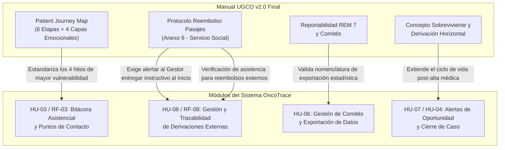

# 📑 Análisis Comparativo y Registro de Actualizaciones
## Manual de Procedimientos UGCO v2.0 vs. Manual de Procedimientos UGCO v2.0 final

> **Institución:** Hospital Dr. Gustavo Fricke (HGF) – Unidad de Gestión de Casos Oncológicos (UGCO)  
> **Proyecto:** OncoTrace – Plataforma de Gestión, Trazabilidad y Acompañamiento Oncológico  
> **Documento Analizado:** `Manual_Procedimientos_UGCO_v2.0 final.docx`  
> **Documento Base / Previo:** `Manual_Procedimientos_UGCO_v2.0.docx`  
> **Fecha de Análisis:** 20 de Octubre de 2026  
> **Autor Institucional del Manual:** E.U. Alejandra Fernández Ávalos (UGCO – HGF)  
> **Estado:** Documento Oficial Validado y Aprobado

---

## 🎯 1. Resumen Ejecutivo de la Comparación

La transición entre el archivo preliminar **`Manual_Procedimientos_UGCO_v2.0.docx`** (emitido el 08 de octubre de 2026) y la entrega definitiva **`Manual_Procedimientos_UGCO_v2.0 final.docx`** (consolidado el 20 de octubre de 2026) representa el paso de un borrador de reestructuración técnica a la **versión canónica y de difusión operativa** del manual.

El documento duplica su peso en disco (de **1.08 MB** a **2.21 MB**) fundamentalmente debido a la incorporación de **dos artefactos visuales de alto valor metodológico y operativo**:
1. **El Mapa de Experiencia del Paciente (*Patient Journey Map*):** Un diagrama longitudinal que modela las 6 etapas del recorrido del paciente oncológico en el HGF, su curva emocional/intensidad de acompañamiento y los puntos de contacto obligatorio.
2. **El Protocolo e Infografía de Reembolso de Pasajes por Derivación (Anexo 6):** Elaborado junto a la Unidad de Servicio Social del HGF, con reglas operativas explícitas sobre derechos de traslado, requisitos documentales y restricciones.

Asimismo, se realizaron ajustes finos de redacción jurídica, extensión de definiciones clave (incorporación del concepto de **"Sobreviviente"** y derivaciones horizontales de red), correcciones de registros estadísticos ministeriales (**REM 7**) y la depuración total de notas editoriales provisionales.

---

## 📊 2. Comparativa Cuantitativa y Estructural

| Métrica / Parámetro | Versión Base (`v2.0.docx`) | Versión Definitiva (`v2.0 final.docx`) | Variación / Observación |
| :--- | :---: | :---: | :--- |
| **Tamaño de archivo** | 1,084,775 bytes (1.03 MB) | 2,207,850 bytes (2.11 MB) | $+103.5\%$ (Duplicación por inserción gráfica) |
| **Archivos en contenedor ZIP** | 15 archivos internos | 22 archivos internos | $+7$ componentes (nuevos assets de medios e imágenes) |
| **Elementos multimedia (`word/media/`)** | 3 imágenes PNG | 5 imágenes PNG | $+2$ infografías de alta resolución |
| **Total caracteres de texto** | 68,937 | 68,995 | $+58$ caracteres netos (afinado y depuración) |
| **Filas en Tabla de Control de Cambios** | 27 filas | 28 filas | $+1$ fila formalizando el Anexo 6 |
| **Total de Anexos formales** | 5 Anexos | 6 Anexos | Incorporación oficial del Anexo 6 |
| **Notas editoriales pendientes** | Presentes en Cap. 10 y 13 | 0 (Completamente resueltas) | Documento cerrado y listo para auditoría |

---

## 🔍 3. Detalle de Cambios Sección por Sección

### 3.1. Capítulo 1: Introducción y Dimensiones del Acompañamiento
* **Atribución formal de diagramas:** Se agregó la leyenda institucional debajo de la flor de dimensiones del cuidado:
  > *«Elaboración propia mesa acompañamiento. Minsal 2025.»*
* **Formato de lectura:** Reestructuración de párrafos para optimizar la legibilidad del texto respecto a la visión biopsicosocial y las transiciones asistenciales.

---

### 3.2. Capítulo 2 y 3: Objetivo General y Alcance
* **Ajuste en la condición del paciente receptor:**
  * **Versión previa:** *«...acompaña de manera directa a la persona con **sospecha o** diagnóstico de cáncer...»*
  * **Versión final:** *«...acompaña de manera directa a la persona con **diagnóstico** de cáncer...»*
* **Fundamento clínico-asistencial:** Se delimita formalmente el alcance de la UGCO: aunque la Unidad apoya la confirmación diagnóstica en etapa temprana, la gestión de casos y el acompañamiento formal por ficha se activa ante la certeza o confirmación diagnóstica (la sospecha inicial recae en la red de APS o en la consulta médica de origen).

---

### 3.3. Capítulo 4: Definiciones Clave
* **Ampliación de la Trayectoria Oncológica:**
  * **Versión previa:** *«...etapas de sospecha, confirmación diagnóstica, etapificación, tratamiento, rehabilitación, seguimiento, cuidados paliativos y alta.»*
  * **Versión final:** *«...etapas de sospecha, confirmación diagnóstica, etapificación, tratamiento, rehabilitación, seguimiento, cuidados paliativos, **alta y sobreviviente**.»*
  * **Impacto:** Se incorpora expresamente el rol de **"Sobreviviente"** (*Cancer Survivorship*), reconociendo las necesidades de seguimiento tardío, secuelas funcionales y reinserción vital post-tratamiento.
* **Integración del Equipo Multidisciplinario:**
  * Se incorpora formalmente a la unidad de **«cuidados paliativos»** dentro del listado taxativo de especialidades del equipo multidisciplinario complementario.
* **Redefinición de «Referencia o derivación»:**
  * **Versión previa:** Limitada a derivaciones *«desde un establecimiento de menor capacidad resolutiva a otro de mayor capacidad»* (enfoque jerárquico tradicional).
  * **Versión final:** Redactada como *«solicitud de evaluación diagnóstica o de tratamiento de una persona derivada **desde un establecimiento a otro** con la finalidad de asegurar la continuidad de la atención.»*
  * **Impacto:** Permite amparar las derivaciones horizontales entre hospitales de alta complejidad de la macrored (por ejemplo, del Hospital Fricke al Hospital Carlos Van Buren para radioterapia/quimioterapia o a institutos de referencia nacional).

---

### 3.4. Capítulo 5: Pilares del Modelo
* **Atribución de autoría:** Se incorporó la leyenda formal: *«Elaboración propia, UGCO 2026»* bajo el esquema de los 4 pilares (Acompañamiento, Coordinación, Gestión de garantías y Comités oncológicos).
* **Depuración tipográfica:** Eliminación de saltos de línea huérfanos.

---

### 3.5. Capítulo 6 y Transición a Capítulo 7: El Viaje del Paciente (Patient Journey Map)
Entre los Puntos de Contacto Obligatorio (Cap. 6) y el inicio de los Procedimientos (Cap. 7), se insertó una infografía metodológica central:

> **Artefacto Visual:** `word/media/image3.png` (1169 × 637 px, 800 KB)  
> **Título:** *«El viaje de la persona con cáncer en el Hospital Dr. Gustavo Fricke – Trayectoria oncológica desde la sospecha hasta el alta»*

#### Estructura del Journey Map incorporado:
1. **6 Etapas Asistenciales:**
   - 1. Sospecha
   - 2. Confirmación Diagnóstica
   - 3. Etapificación
   - 4. Tratamiento
   - 5. Rehabilitación y Cuidados Paliativos
   - 6. Seguimiento y Alta
2. **Curva de Intensidad del Acompañamiento:** Visualiza los picos de máxima vulnerabilidad emocional y operativa que justifican los puntos de contacto obligatorio:
   - Comunicación del diagnóstico.
   - Período de etapificación e incertidumbre de exámenes.
   - Alta de una hospitalización (cirugía/complicación).
   - Término del tratamiento y retorno a la vida cotidiana (ansiedad de desvinculación).
3. **Cuatro Capas de Experiencia por Etapa:**
   - *Lo que ocurre en el proceso:* Hitos clínicos formales (interconsulta, biopsia, comité, tratamiento).
   - *Lo que vive la persona:* Expresión cualitativa vivencial en primera persona (*«No sé qué tengo»*, *«Esperar el resultado fue lo más difícil»*, *«Los efectos me agotan»*, *«Terminó el tratamiento pero el miedo a que vuelva no se va»*).
   - *Lo que necesita:* Apoyo práctico, certeza en plazos, comprensión de información y coordinación activa.
   - *Cómo acompaña el gestor de casos:* Acciones estandarizadas de acompañamiento, tramitación y seguimiento.

---

### 3.6. Capítulo 7: Procedimientos Asistenciales y Administrativos
* **Corrección en Procedimiento 7.4 (Comités Oncológicos):**
  * Se corrige el código del Registro Estadístico Mensual ministerial:
    * **Versión previa:** *«...REM **0.7** oncológico...»*
    * **Versión final:** *«...REM **7** oncológico...»*
* **Ajuste gramatical en Procedimiento 7.7 (Redes de Derivación):** Corrección de puntuación de incisos normativos (*«...toda modificación que la Unidad detecte, sea temporal o definitiva,...»*).
* **Reestructuración Mayor en Procedimiento 7.9 (Apoyo ante dificultades económicas):**
  * La mención genérica previa de "Financiamiento de traslado" fue reemplazada por una especificación rigurosa del **«Reembolso de pasajes por derivación»**:
    * Se formaliza que la **Unidad de Servicio Social** del HGF es la responsable de reembolsar los pasajes de locomoción pública.
    * Se instruye la **entrega obligatoria y anticipada del instructivo al inicio del tratamiento** a toda persona derivada fuera de Viña del Mar, evitando que el paciente pierda el derecho a reembolso al finalizar sus ciclos por falta de registro diario en el centro emisor.
    * Se fijan restricciones estrictas: **Solo se reembolsa locomoción pública** (microbús, metro/tren, bus interurbano y colectivo). **Quedan expresamente excluidos los vehículos particulares, gastos de bencina o aplicaciones de movilidad (Uber, Cabify, Didi)**.
    * Se exige la conservación íntegra de boletos y solicitud del certificado de asistencia en cada atención médica externa.

---

### 3.7. Capítulos 9, 10, 11 y 13: Depuración de Notas y Cierre Editorial
* **Capítulo 9 (Patologías GES):** Se retiró un párrafo redundante que explicaba la discrepancia histórica de numeración del Decreto Supremo N° 29 de 2025.
* **Capítulo 10 (Patologías No GES):** Se eliminó la etiqueta de borrador: *`[Pendiente de definición: plazos institucionales por etapa...]`*.
* **Capítulo 11 (Derivaciones):** Se suprimió la cláusula genérica respecto a la responsabilidad financiera a todo evento entre Servicios de Salud.
* **Capítulo 13 (Indicadores de Gestión):** Se removió el aviso de borrador editorial *`[Pendiente de definición: metas de cumplimiento...]`*, consolidando la terna de indicadores trazadores oficiales:
  1. *Cobertura de gestor asignado* (Meta mensual institucional).
  2. *Valoración inicial aplicada* (Ficha clínica y Anexo 1).
  3. *Oportunidad de derivación a la red* ($<7$ días desde resolución del comité).

---

### 3.8. Capítulo 14: Anexos y Nueva Infografía Institucional
Se oficializa la estructura de 6 Anexos:
* **Anexo 1:** Pauta de valoración inicial por dominios.
* **Anexo 2:** Ficha de egreso y cierre de caso.
* **Anexo 3:** Derechos de las personas cuidadoras (Ley N° 21.168, N° 21.380, N° 21.805).
* **Anexo 4:** Fichas clínicas y registro de comités oncológicos (Circular N° 20 de 2022).
* **Anexo 5:** Mapa de procesos de la gestión de casos oncológicos (`image4.png`).
* **Anexo 6 (NUEVO): Reembolso de pasajes por derivación (`image5.png`, 1539 × 1659 px, 494 KB):**
  * Diseñado como una guía visual directa para el paciente y cuidador:
    * *¿Quiénes pueden acceder?:* Pacientes derivados por sistema informático o interconsulta del HGF a centros de la red.
    * *Criterios Sí/No:* Verde (locomoción pública) vs. Naranja (autos particulares, combustible o apps).
    * *Documentación requerida:* Certificado sin enmiendas, boletos de pasaje y cédula de identidad.
    * *Lugar y Horario de Atención:* Unidad de Servicio Social, 1er piso del edificio nuevo HGF (Lunes a viernes de 8:30 a 12:00 hrs) y pago en Contabilidad (hospital histórico).
    * *Destinos cubiertos:* Red SSVQP, Valparaíso, Santiago y otras regiones.
    * *Canal de contacto:* Teléfono 32 257 7763.

---

### 3.9. Capítulos 15 y 16: Bibliografía y Tabla de Cambios
* **Bibliografía:** Se incorporó formalmente la referencia documental técnica:
  > *Hospital Dr. Gustavo Fricke. (s.f.). Instructivo de reembolso de pasajes. Unidad de Servicio Social, Servicio de Salud Viña del Mar – Quillota.*
* **Tabla de Control de Cambios:** Se agrega el registro número 28:
  * **Modificación:** *«Incorporación del beneficio de reembolso de pasajes por derivación y de su instructivo como Anexo 6»*
  * **Responsable:** E.U. Alejandra Fernández Ávalos
  * **Fecha:** Octubre 2026
  * **Versión:** 2.0 (Aprobada definitiva)

---

## 💻 4. Impacto Estratégico en el Sistema OncoTrace

Las actualizaciones contenidas en la versión final del manual impactan directamente las especificaciones de ingeniería de software del repositorio [OncoTrace](https://github.com/br1fz/OncoTrace):

### 1. Refuerzo a la Historia de Usuario HU-08 (Derivaciones a Macrored - HCVB)
* El sistema OncoTrace debe contemplar en el expediente de derivación un **marcador o checklist de verificación** que confirme:
  * Entrega del **Instructivo de Reembolso de Pasajes** al paciente.
  * Consignación de si el paciente cuenta con red local o requiere tramitación de pasajes hacia el centro receptor (por ejemplo, HCVB en Valparaíso o INCANCER en Santiago).
* En el módulo de contrarreferencia, OncoTrace puede habilitar la carga digital de los certificados de asistencia emitidos por los centros externos para facilitar el cobro ante Servicio Social.

### 2. Refuerzo a la Historia de Usuario HU-03 (Bitácora de Acompañamiento)
* El Journey Map oficializa los momentos exactos de la curva de vulnerabilidad donde el sistema debe desplegar **recordatorios proactivos al Gestor**:
  1. *Hito 1:* Comunicación del diagnóstico (validar comprensión e IPD).
  2. *Hito 2:* Estudios de extensión/etapificación (coordinar horas complejas).
  3. *Hito 3:* Alta de hospitalización médica o quirúrgica.
  4. *Hito 4:* Cierre de ciclos de terapia activa y retorno a la vida diaria.

### 3. Ajuste Conceptual del Ciclo de Vida del Paciente
* La incorporación del concepto de **«Sobreviviente»** amplía la trazabilidad de OncoTrace: el cierre administrativo de tratamiento no elimina al paciente del radar, sino que habilita la modalidad de **vigilancia periódica y soporte multidisciplinario** (kinesiología, psicosocial, nutrición).

---

## 📌 5. Conclusión

El archivo `Manual_Procedimientos_UGCO_v2.0 final.docx` consolida la madurez operativa de la Unidad de Gestión de Casos Oncológicos. Los cambios no alteran la arquitectura de procesos modelada en `to-be.bpmn`, sino que **enriquecen significativamente los requisitos funcionales de atención centrada en la persona**, aportando pautas normativas concretas respecto a beneficios sociales (traslados y pasajes) y formalizando el viaje integral del paciente oncológico en el Hospital Dr. Gustavo Fricke.
